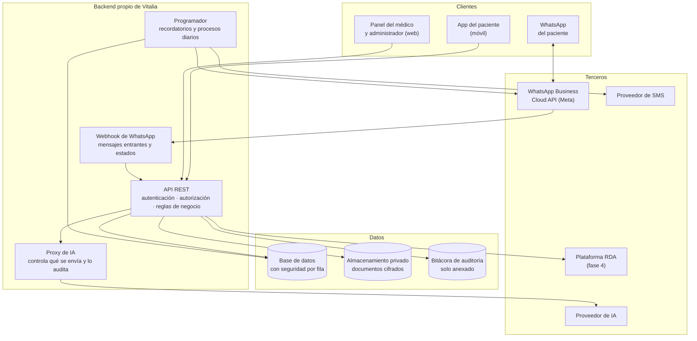
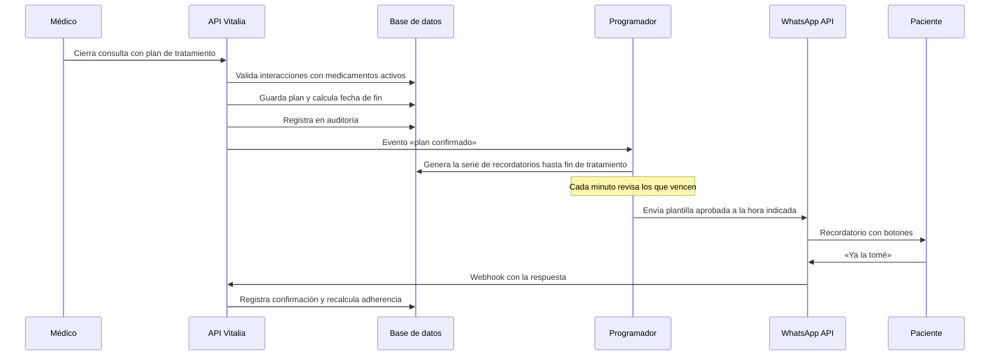

# Arquitectura

Cómo se construye Vitalia y, sobre todo, **por qué así**. Cada decisión de este documento responde a un requisito no funcional del proyecto, no a una preferencia técnica.

**Estado:** propuesta de arquitectura. El stack concreto está abierto — ver [Decisiones abiertas](#decisiones-abiertas) al final.

---

## 1. La regla que ordena todo

> **El cliente nunca habla con un tercero. Todo pasa por backend propio.**

De esa sola regla se derivan la mitad de las decisiones de este documento. La app móvil no llama a WhatsApp, ni al proveedor de SMS, ni al de IA, ni al almacenamiento. Llama a la API de Vitalia, y Vitalia decide qué sale, hacia dónde y con qué credenciales.

Viene de RNF-02, y existe porque en una versión anterior las claves de API viajaban dentro del cliente: cualquiera que descomprimiera el APK las tenía.

---

## 2. Vista general

Lo que **no** hay en ese diagrama es tan importante como lo que hay: ninguna flecha sale de un cliente hacia un tercero.

---

## 3. Componentes

### 3.1 API REST

El único punto de entrada. Responsabilidades:

- Autenticar (contraseña o código por SMS) y emitir tokens de sesión con expiración y renovación.
- Resolver el rol desde la base de datos y autorizar cada operación. **Ningún usuario privilegiado escrito en el código** (RF-04).
- Aplicar las reglas de negocio: disponibilidad sin choques, vigencia de tratamientos, permisos del cuidador.
- Escribir en la bitácora de auditoría **dentro de la misma transacción** de la operación clínica: si el registro de auditoría falla, la operación no se da por exitosa (HU-020, CA-4).

### 3.2 Base de datos

Relacional, con **seguridad a nivel de fila obligatoria** en toda tabla con datos de salud.

La aplicación no es la única defensa: la base filtra por la identidad autenticada. Si un endpoint tiene un error y olvida un `WHERE`, la base igual no devuelve filas ajenas.

**Prohibido:** políticas con condición abierta (`USING true`) en tablas clínicas. La suite de pruebas incluye pruebas negativas que **fallan el despliegue** si alguna política queda abierta (HU-035, CA-4).

Modelo de acceso:

| Rol | Qué filas ve |
|---|---|
| Paciente | Solo aquellas cuyo paciente es su identidad |
| Médico | Solo pacientes con relación de atención vigente |
| Cuidador | Solo recordatorios y plan de cuidado del paciente que lo autorizó |
| Administrador | Datos operativos de su clínica; sin acceso clínico |

La **relación de atención vigente** es una entidad propia, con caducidad. Es lo que impide que un médico conserve acceso a un paciente que ya no atiende.

### 3.3 Almacenamiento de documentos

Bucket **privado**, cifrado en reposo, sin ninguna ruta pública.

El acceso siempre es: cliente pide abrir un documento → la API valida permisos → emite una **URL firmada con vigencia máxima de 15 minutos** → registra la emisión en auditoría. Un enlace filtrado caduca solo.

### 3.4 Programador de tareas

Procesos que corren sin que nadie los dispare:

| Proceso | Frecuencia | Qué hace |
|---|---|---|
| Despacho de recordatorios | cada minuto | Envía los que vencen, dentro de una ventana de ±5 minutos (RNF-13) |
| Cierre de tratamientos | diario | Marca los vencidos y cancela sus recordatorios pendientes |
| Evaluación de incumplimiento | diario | Genera, actualiza y cierra alertas de adherencia |
| Escalamiento de canal | por evento | Reintenta por SMS lo que WhatsApp no entregó |

Los recordatorios se **generan por adelantado** como serie al confirmar el plan, no se calculan al vuelo. Así un cambio en el plan cancela y regenera de forma explícita, y siempre se puede consultar qué se va a enviar y cuándo.

### 3.5 Integración con WhatsApp

Sobre la **API oficial de WhatsApp Business Cloud** (Meta) o un BSP certificado. Nunca librerías no oficiales ni números personales (RNF-11): eso arriesga el bloqueo de la línea de la clínica.

Dos reglas que el backend hace cumplir antes de llamar a Meta:

1. **Fuera de la ventana de 24 horas** solo salen plantillas aprobadas. Un intento de texto libre se bloquea antes de la llamada y queda registrado.
2. **Dentro de la ventana** (el paciente escribió hace menos de 24 h) se permite mensaje libre.

El sistema lleva su propio registro del estado de cada plantilla y alerta al administrador si Meta rechaza o suspende alguna.

### 3.6 Proxy de IA (fase 3)

La historia clínica **no viaja desde el cliente**. El médico pregunta → la API valida que el paciente haya dado consentimiento → el proxy arma el contexto decidiendo qué fragmentos se envían → llama al proveedor con credenciales del servidor → registra el acceso en auditoría.

Tres controles:

- Sin consentimiento vigente del paciente, la llamada se bloquea (RF-46).
- Se excluyen los identificadores directos que no sean necesarios para responder.
- El asistente responde **solo con lo registrado** en la historia y declara cuándo no tiene el dato, en vez de inferirlo.

### 3.7 Bitácora de auditoría

Tabla de **solo anexado**: la aplicación no tiene permisos de actualización ni borrado sobre ella.

Registra actor, rol, paciente afectado, acción, fecha y hora, y origen de la petición. Cubre consulta, creación y modificación de información clínica, emisión de URLs firmadas y cada consulta al asistente de IA.

Esto no es una funcionalidad opcional: es lo que la normativa exige y lo que permite responder un reclamo. El paciente puede consultar quién accedió a su historia (HU-070).

---

## 4. Cómo se ve una operación completa

**El médico cierra una consulta y el paciente empieza a recibir recordatorios:**

El indicador de adherencia que ve el médico sale de ese último paso. Sin la confirmación del paciente no hay dato, y sin dato no hay diferencial: por eso las historias HU-044 a HU-049 son las que sostienen la promesa comercial del producto.

---

## 5. Requisitos no funcionales y dónde se resuelven

| Requisito | Se resuelve en |
|---|---|
| RNF-01 Seguridad por fila real | Base de datos + pruebas negativas en el despliegue |
| RNF-02 Sin claves en el cliente | Toda integración pasa por el backend |
| RNF-03 Documentos cifrados con URL firmada | Almacenamiento privado + servicio de firma |
| RNF-04 Contraseñas con hash resistente | argon2 o bcrypt con sal única |
| RNF-05 TLS 1.2+ | Terminación TLS en el borde |
| RNF-06 Auditoría de solo anexado | Tabla sin permisos de update/delete |
| RNF-07 a RNF-10 Cumplimiento normativo | Consentimientos versionados y auditoría |
| RNF-11 WhatsApp oficial | API de Meta o BSP certificado |
| RNF-12 Respuesta bajo 2 s en 4G | Índices, paginación y respuestas compactas |
| RNF-13 Recordatorios ±5 min | Programador con revisión por minuto |
| RNF-14 Disponibilidad 99.5% | Despliegue gestionado con monitoreo |
| RNF-15 WCAG 2.1 AA | Modo accesible y revisión de contraste |
| RNF-16 Respaldo diario | Copias automáticas con restauración probada |

---

## 6. Orden de construcción

El orden no es por importancia, es por dependencia técnica. Sale de [historias-de-usuario/RELACIONES.md](historias-de-usuario/RELACIONES.md):

1. **Cimientos** — roles y permisos en base de datos (HU-005), seguridad por fila (HU-035), almacenamiento con URLs firmadas (HU-036), motor de disponibilidad (HU-008), catálogo de medicamentos (HU-022).
2. **Identidad** — registro, ingreso, recuperación (HU-001 a HU-004).
3. **Ciclo de la cita** — agendar, mover, cancelar, consultar (HU-007 a HU-014).
4. **Historia clínica** — nota clínica y documentos (HU-015 a HU-020).
5. **Plan de tratamiento** — medicamentos, cuidados, vigencia (HU-021 a HU-028).
6. **Recordatorios** — generación y envío multicanal (HU-029 a HU-034).
7. **Adherencia** — confirmación, indicador, panel y alertas (HU-044 a HU-050).

Los cinco cimientos del paso 1 son transversales: casi todo lo demás depende de ellos, así que atrasarlos atrasa el proyecto entero.

---

## Decisiones abiertas

Lo que el brief **no** define y hay que decidir antes de empezar:

| Decisión | Opciones | Consideración |
|---|---|---|
| **Cliente móvil** | Flutter · React Native · PWA | El brief exige funcionar en gama baja de Android y con conectividad intermitente. Una PWA abarata el desarrollo, pero complica las notificaciones push. |
| **Backend** | Node/TypeScript · Python · .NET | Cualquiera cumple. Pesa más el equipo que lo mantendrá que el lenguaje. |
| **Base de datos** | PostgreSQL gestionado · Supabase | La seguridad por fila es nativa en PostgreSQL. Supabase la trae configurada, pero es justo donde la versión anterior falló con `USING true`: la herramienta no evita el error, la disciplina sí. |
| **Proveedor de WhatsApp** | Meta directo · Twilio · 360dialog | Un BSP simplifica la aprobación de plantillas y la facturación; Meta directo es más barato por volumen. |
| **Catálogo de medicamentos** | INVIMA · base comercial | Determina el costo y la frecuencia de actualización. Afecta HU-022 y HU-023. |
| **Base de interacciones** | Fuente comercial · lista curada propia | La verificación de interacciones (HU-023) no puede salir de una lista improvisada: es criterio clínico. |

**Una advertencia sobre la última fila.** HU-023 avisa al médico sobre interacciones entre medicamentos. Si esa base de datos es incompleta o está desactualizada, el sistema puede dar una falsa tranquilidad en una decisión clínica. La historia ya exige que la advertencia aclare que no sustituye el criterio del médico, pero la fuente de datos debe elegirse con el equipo clínico, no por costo.
