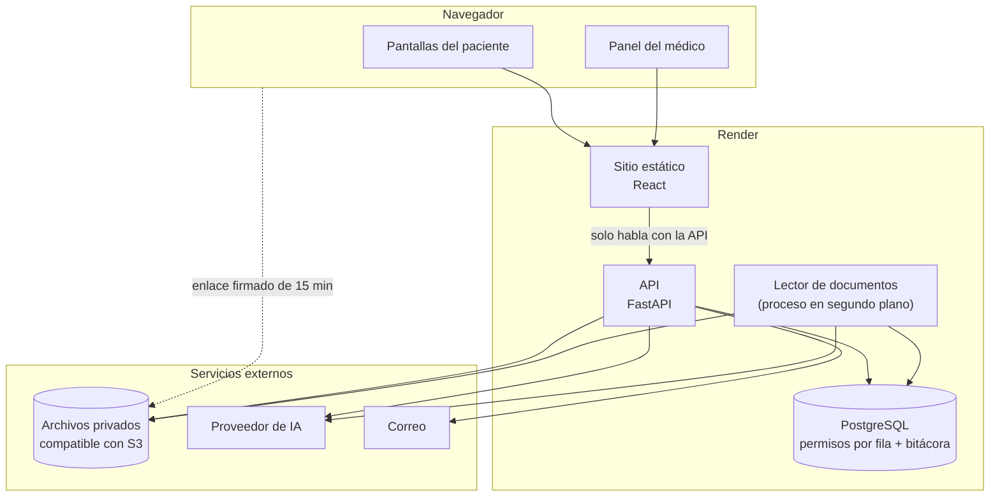

# Arquitectura

**Fase del ciclo de vida:** Diseño
**Versión:** 1.0 · 12 de octubre de 2026

Cómo se construye Vitalia y por qué así. Cada decisión responde a un requisito de [planificacion/02-requisitos.md](../planificacion/02-requisitos.md).

---

## 1. Decisiones de tecnología

| Tema | Decisión | Por qué |
|---|---|---|
| Servidor | **Python con FastAPI** | Lo eligió el dueño del proyecto. Python además es cómodo para leer PDF e imágenes |
| Base de datos | **PostgreSQL administrado en Render** | Trae permisos por fila de forma nativa, que es lo que exige HU-036 |
| Pantallas | **React con Vite y TypeScript** | Toda la aplicación está detrás del ingreso y es muy interactiva: calendario, formularios, visor y conversación con el asistente. Astro está pensado para sitios de contenido con poca interacción, y aquí habría que montar React encima de todos modos |
| Publicación | **Render**: un servicio web para la API, un sitio estático para las pantallas y la base de datos | Un solo proveedor para las tres piezas |
| Archivos | **Almacenamiento compatible con S3** (propuesta: Cloudflare R2) | Render no ofrece almacenamiento de archivos. Se necesita un espacio privado, cifrado y con enlaces firmados (HU-027) |
| Inteligencia artificial | **Qwen** por la plataforma internacional de Alibaba Cloud, detrás de un adaptador intercambiable | Ver [04-asistente-ia.md](04-asistente-ia.md). El adaptador permite cambiar de proveedor sin tocar el resto |
| Correo | Proveedor de correo por API (propuesta: Resend) | Recuperación de contraseña y avisos de cita |

Con esto quedan cerradas las decisiones A-01 a A-06 de [decisiones y supuestos](../planificacion/04-decisiones-y-supuestos.md).

## 2. Vista general



**La regla que ordena todo:** el navegador solo habla con la API de Vitalia. Nunca llama directamente a la IA ni al correo, y a los archivos solo llega con un enlace temporal que la API le entrega después de validar el permiso.

## 3. Componentes

### 3.1 Pantallas (React)

- Una sola aplicación con dos zonas según el rol: paciente (pensada primero para celular) y médico (pensada primero para computador).
- No guarda datos clínicos en el navegador. La sesión viaja en una cookie que el código de la página no puede leer.
- Piezas que se toman hechas: calendario semanal y mensual, y visor de PDF.

### 3.2 API (FastAPI)

Único punto de entrada. Hace cuatro cosas en cada petición:

1. Identifica la sesión y el rol.
2. Verifica el permiso de la operación contra la matriz de la base de datos (HU-006).
3. Abre una transacción y le dice a la base quién es el usuario, para que los permisos por fila filtren (HU-036).
4. Escribe la bitácora dentro de esa misma transacción (HU-037).

El contrato está en [03-api.md](03-api.md).

### 3.3 Base de datos

- La API se conecta con un usuario de base de datos **sin privilegios de dueño**. Las tablas con datos de salud tienen permisos por fila forzados, de modo que ni un error de programación devuelve filas ajenas.
- La bitácora solo admite inserciones: el usuario de la API no tiene permiso de modificar ni borrar, y un disparador lo impide aunque alguien lo intente.
- Dos citas no pueden ocupar el mismo tiempo: lo garantiza una restricción de la propia base, no solo el código (HU-011).

El detalle está en [02-modelo-de-datos.md](02-modelo-de-datos.md).

### 3.4 Archivos

- Un espacio privado, cifrado, sin ninguna dirección pública.
- El archivo se sube a través de la API, que valida formato y tamaño antes de guardarlo.
- Para abrirlo, la API emite un enlace firmado de máximo 15 minutos y lo registra en la bitácora.

### 3.5 Lector de documentos

Proceso que corre en segundo plano y deja cada documento listo para el asistente (HU-031):

| Tipo de documento | Cómo se lee | ¿Sale del servidor? |
|---|---|---|
| PDF con texto | Se extrae el texto página por página dentro del servidor | No |
| PDF escaneado o foto | Un modelo de visión reconoce el texto página por página | Sí, va al proveedor de IA |

Como la lectura de fotos y escaneados envía el contenido al proveedor de IA, **solo corre si el paciente ya autorizó el uso de IA**. Mientras no lo haga, ese documento queda "sin leer": el médico lo puede abrir en el visor, pero el asistente no lo usa.

En la primera versión el lector corre dentro del mismo servicio de la API y toma los trabajos de una cola guardada en la base. Si el volumen crece, se pasa a un servicio aparte sin cambiar el código.

### 3.6 Asistente de IA

Ver [04-asistente-ia.md](04-asistente-ia.md).

### 3.7 Sesiones y contraseñas

| Tema | Diseño |
|---|---|
| Contraseñas | Hash con argon2id y sal única (RNF-04) |
| Sesión | Identificador aleatorio guardado en una cookie segura que la página no puede leer; en la base se guarda solo su hash. Se puede anular desde el servidor (HU-007) |
| Inactividad | La sesión vence a los 30 minutos sin uso |
| Intentos fallidos | Cinco seguidos bloquean el ingreso 15 minutos |
| Enlaces de un solo uso | Recuperación (30 minutos), activación de cuenta y puesta en marcha. Se guarda el hash, nunca el enlace |

## 4. Dónde se cumple cada requisito no funcional

| Requisito | Mecanismo |
|---|---|
| RNF-01 Permisos por fila | Políticas en PostgreSQL + pruebas que hacen fallar el despliegue si una tabla queda sin política |
| RNF-02 Claves fuera del navegador | Las claves viven en las variables de entorno del servicio de la API |
| RNF-03 Documentos cifrados | Espacio privado cifrado + enlaces firmados de 15 minutos |
| RNF-04 Contraseñas | argon2id |
| RNF-05 Tráfico cifrado | Render entrega HTTPS en todos los servicios |
| RNF-06 Bitácora | Tabla de solo inserción |
| RNF-07 Ley 1581 | Autorizaciones con versión y fecha; eliminación de documentos con su texto |
| RNF-08 Mínimo de datos a la IA | El servidor arma el contexto y retira identificadores antes de enviar |
| RNF-09 El asistente no diagnostica | Instrucciones fijas del asistente + pruebas con preguntas de diagnóstico |
| RNF-10 Rendimiento | Índices, paginación y respuesta del asistente por partes |
| RNF-11 Accesibilidad | Criterios WCAG 2.1 AA aplicados desde el prototipo |
| RNF-12 Respaldo | Copias continuas de la base de datos del plan pago, con restauración a cualquier momento de los últimos 3 días (7 en el plan Pro), y versiones en el espacio de archivos. Conservar copias por más tiempo exige una exportación periódica al espacio de archivos; está por decidir |
| RNF-13 Disponibilidad | Servicio web en plan pago (el gratuito se duerme tras 15 minutos sin uso) |
| RNF-14 Equipos modestos | Pantallas livianas y pensadas primero para celular |

## 5. Ambientes y costo

| Ambiente | Para qué | Dónde |
|---|---|---|
| Local | Desarrollo | El computador de quien programa, con datos inventados |
| Pruebas | Verificar cada historia contra sus criterios | Render, con datos inventados |
| Producción | Uso real | Render, plan pago |

**Costo mensual aproximado de producción**

| Pieza | Costo |
|---|---|
| Servicio web de la API | 7 USD |
| Base de datos PostgreSQL | desde 6 USD |
| Sitio estático | 0 |
| Archivos | 0 dentro del cupo gratuito |
| Correo | 0 dentro del cupo gratuito |
| IA | Por uso; ver [04-asistente-ia.md](04-asistente-ia.md) |
| **Total** | **unos 13 a 20 USD más el uso de IA** |

El plan gratuito de Render sirve para una demostración, pero no para operar: el servicio web se duerme tras 15 minutos sin uso, y la base de datos gratuita se elimina a los 30 días y no tiene respaldos. Estos límites se confirmaron en la documentación oficial el 13 de octubre de 2026. Los precios, en cambio, salen de artículos de terceros y deben confirmarse en la página oficial antes de contratar.

**Ubicación de los datos.** Render no tiene centro de datos en Latinoamérica: sus regiones son Oregon, Ohio y Virginia en Estados Unidos, Fráncfort y Singapur (confirmado en su documentación el 13 de octubre de 2026). Se usaría una del este de Estados Unidos. La base de datos y los archivos quedarían fuera de Colombia, lo que amplía la pregunta 2 del [marco normativo](../planificacion/03-marco-normativo.md): ya no es solo la IA, también el alojamiento.

## 6. Riesgos y pruebas de concepto

Antes de construir en serio conviene despejar cuatro dudas con pruebas pequeñas:

| # | Duda | Prueba | Historia |
|---|---|---|---|
| 1 | ¿La lectura de fotos y de letra a mano es suficientemente buena? | Leer cinco documentos inventados (dos PDF con texto, una foto nítida, una de letra a mano y un PDF largo) y medir cuánto texto queda correcto | HU-031 |
| 2 | ¿El asistente cita bien el documento y la página? | Preguntas con respuesta conocida sobre esos documentos, en el mismo guion | HU-034 |
| 3 | ¿Los permisos por fila funcionan con un usuario sin privilegios en la base de Render? | Crear el usuario, dos pacientes y comprobar que uno no ve al otro. Render permite crear usuarios adicionales; su documentación no dice qué privilegios trae el usuario por defecto | HU-036 |
| 4 | ¿La cookie de sesión funciona entre el sitio estático y la API? | Publicar un ingreso mínimo en Render con dominio propio | HU-004 |

La primera es la que más pesa: si la lectura falla, el asistente no sirve.

## 7. Organización del código

```
vitalia-proyecto/
├── planificacion/        fase 1
├── diseno/               fase 2
├── historias-de-usuario/
├── servidor/             API en FastAPI, migraciones y pruebas
└── pantallas/            aplicación en React
```

Las carpetas `servidor/` y `pantallas/` se crean al empezar la fase de Desarrollo.

## Fuentes

- [Render: regiones](https://render.com/docs/regions)
- [Render: límites del plan gratuito](https://render.com/docs/free)
- [Render: respaldos de PostgreSQL](https://render.com/docs/postgresql-backups)
- [Render: usuarios de PostgreSQL](https://render.com/docs/postgresql-credentials)
- [Render: planes gratuitos en 2026](https://render.com/articles/platforms-with-a-real-free-tier-for-developers-in-2026.md)
- [Render: precios de PostgreSQL (Kuberns)](https://kuberns.com/blogs/render-postgres-pricing-setup-limits/)
