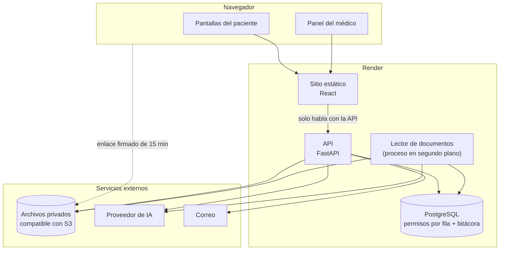
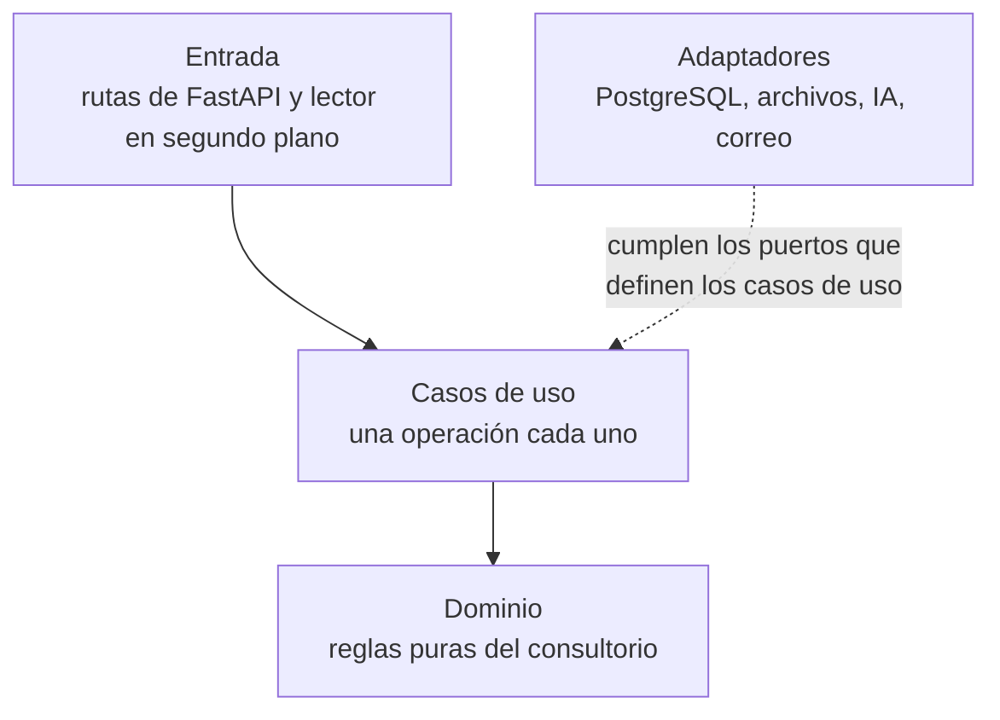

# Arquitectura

**Fase del ciclo de vida:** Diseño
**Versión:** 1.2 · 13 de octubre de 2026

Cómo se construye Vitalia y por qué así. Cada decisión responde a un requisito de [planificacion/02-requisitos.md](../planificacion/02-requisitos.md).

---

## 1. Decisiones de tecnología

| Tema | Decisión | Por qué |
|---|---|---|
| Servidor | **Python con FastAPI** | Lo eligió el dueño del proyecto. Python además es cómodo para leer PDF e imágenes |
| Base de datos | **PostgreSQL administrado en Render** | Trae permisos por fila de forma nativa, que es lo que exige HU-036 |
| Pantallas | **React con Vite y TypeScript** | Toda la aplicación está detrás del ingreso y es muy interactiva: calendario, formularios, visor y conversación con el asistente. Astro está pensado para sitios de contenido con poca interacción, y aquí habría que montar React encima de todos modos |
| Publicación | **Render**: un servicio web para la API, un sitio estático para las pantallas y la base de datos | Un solo proveedor para las tres piezas |
| Archivos | **Almacenamiento compatible con S3** (propuesta: Cloudflare R2) | Render no ofrece almacenamiento de archivos. Se necesita un espacio privado, cifrado y con enlaces firmados (HU-027) |
| Inteligencia artificial | **Qwen** por la plataforma internacional de Alibaba Cloud, detrás de un adaptador intercambiable | Ver [04-asistente-ia.md](04-asistente-ia.md). El adaptador permite cambiar de proveedor sin tocar el resto |
| Correo | Proveedor de correo por API (propuesta: Resend) | Recuperación de contraseña y avisos de cita |
| Organización del código | **Arquitectura limpia**: capas con las dependencias hacia adentro | Lo pidió el dueño del proyecto (D-19). Las reglas del consultorio quedan separadas de FastAPI, de la base y de los proveedores, y se prueban sin ellos. Ver la sección 7 |

Con esto quedan cerradas las decisiones A-01 a A-06 de [decisiones y supuestos](../planificacion/04-decisiones-y-supuestos.md).

## 2. Vista general



**La regla que ordena todo:** el navegador solo habla con la API de Vitalia. Nunca llama directamente a la IA ni al correo, y a los archivos solo llega con un enlace temporal que la API le entrega después de validar el permiso.

## 3. Componentes

### 3.1 Pantallas (React)

- Una sola aplicación con dos zonas según el rol: paciente (pensada primero para celular) y médico (pensada primero para computador).
- No guarda datos clínicos en el navegador. La sesión viaja en una cookie que el código de la página no puede leer.
- Piezas que se toman hechas: calendario semanal y mensual, y visor de PDF.

### 3.2 API (FastAPI)

Único punto de entrada. Hace cuatro cosas en cada petición:

1. Identifica la sesión y el rol.
2. Verifica el permiso de la operación contra la matriz de la base de datos (HU-006).
3. Abre una transacción y le dice a la base quién es el usuario, para que los permisos por fila filtren (HU-036).
4. Escribe la bitácora dentro de esa misma transacción (HU-037).

El contrato está en [03-api.md](03-api.md). Cómo se reparten estos pasos entre las capas del código está en la sección 7.

### 3.3 Base de datos

- La API se conecta con un usuario de base de datos **sin privilegios de dueño**. Las tablas con datos de salud tienen permisos por fila forzados, de modo que ni un error de programación devuelve filas ajenas.
- La bitácora solo admite inserciones: el usuario de la API no tiene permiso de modificar ni borrar, y un disparador lo impide aunque alguien lo intente.
- Dos citas no pueden ocupar el mismo tiempo: lo garantiza una restricción de la propia base, no solo el código (HU-011).
- Una atención cerrada de la historia clínica no se puede modificar ni borrar: lo impide un disparador de la base (HU-044).
- Lo que ocurre sin sesión (ingreso, registro, recuperación) pasa por funciones de la base que hacen una sola cosa cada una. Sin sesión la API no puede leer ninguna tabla.

El detalle está en [02-modelo-de-datos.md](02-modelo-de-datos.md).

### 3.4 Archivos

- Un espacio privado, cifrado, sin ninguna dirección pública.
- El archivo se sube a través de la API, que valida formato y tamaño antes de guardarlo.
- Para abrirlo, la API emite un enlace firmado de máximo 15 minutos y lo registra en la bitácora.

### 3.5 Lector de documentos

Proceso que corre en segundo plano y deja cada documento listo para el asistente (HU-031):

| Tipo de documento | Cómo se lee | ¿Sale del servidor? |
|---|---|---|
| PDF con texto | Se extrae el texto página por página dentro del servidor | No |
| PDF escaneado o foto | Un modelo de visión reconoce el texto página por página | Sí, va al proveedor de IA |

Como la lectura de fotos y escaneados envía el contenido al proveedor de IA, **solo corre si el paciente ya autorizó el uso de IA**. Mientras no lo haga, ese documento queda "sin leer": el médico lo puede abrir en el visor, pero el asistente no lo usa.

En la primera versión el lector corre dentro del mismo servicio de la API y toma los trabajos de una cola guardada en la base. Si el volumen crece, se pasa a un servicio aparte sin cambiar el código.

El envío de los avisos de cita funciona igual: cada aviso se guarda ya redactado en una cola y un proceso en segundo plano lo envía y reintenta. Los dos procesos trabajan ante la base con la identidad `sistema`, que solo ve esas colas y lo mínimo para hacer su tarea.

### 3.6 Asistente de IA

Ver [04-asistente-ia.md](04-asistente-ia.md).

### 3.7 Sesiones y contraseñas

| Tema | Diseño |
|---|---|
| Ingreso | Tipo y número de documento más contraseña (D-20). El documento identifica; la contraseña es propia. El médico entra igual |
| Contraseñas | Hash con argon2id y sal única (RNF-04) |
| Sesión | Identificador aleatorio guardado en una cookie segura que la página no puede leer; en la base se guarda solo su hash. Se puede anular desde el servidor (HU-007) |
| Inactividad | La sesión vence a los 30 minutos sin uso |
| Intentos fallidos | Cinco seguidos desde un mismo equipo bloquean el ingreso a esa cuenta desde ese equipo por 15 minutos. Como el documento es fácil de conocer, el bloqueo no es de toda la cuenta: así nadie puede dejar por fuera al dueño. Además hay un tope de intentos por equipo, sea cual sea la cuenta |
| Firma de la historia clínica | Para cerrar una atención el médico confirma con su contraseña. Queda su nombre, su registro, su documento, la fecha y la hora (S-19) |
| Enlaces de un solo uso | Recuperación (30 minutos), activación de cuenta y puesta en marcha. Se guarda el hash, nunca el enlace |

## 4. Dónde se cumple cada requisito no funcional

| Requisito | Mecanismo |
|---|---|
| RNF-01 Permisos por fila | Políticas en PostgreSQL + pruebas que hacen fallar el despliegue si una tabla queda sin política |
| RNF-02 Claves fuera del navegador | Las claves viven en las variables de entorno del servicio de la API |
| RNF-03 Documentos cifrados | Espacio privado cifrado + enlaces firmados de 15 minutos |
| RNF-04 Contraseñas | argon2id |
| RNF-05 Tráfico cifrado | Render entrega HTTPS en todos los servicios |
| RNF-06 Bitácora | Tabla de solo inserción |
| RNF-07 Ley 1581 | Autorizaciones con versión y fecha; eliminación de documentos con su texto |
| RNF-08 Mínimo de datos a la IA | El servidor arma el contexto y retira identificadores antes de enviar |
| RNF-09 El asistente no diagnostica | Instrucciones fijas del asistente + pruebas con preguntas de diagnóstico |
| RNF-10 Rendimiento | Reglas de la sección 8: una pantalla, una operación; índices, paginación, trabajo pesado por cola y respuesta del asistente por partes |
| RNF-11 Accesibilidad | Criterios WCAG 2.1 AA aplicados desde el prototipo |
| RNF-12 Respaldo | Copias continuas de la base de datos del plan pago, con restauración a cualquier momento de los últimos 3 días (7 en el plan Pro), y versiones en el espacio de archivos. Conservar copias por más tiempo exige una exportación periódica al espacio de archivos; está por decidir |
| RNF-13 Disponibilidad | Servicio web en plan pago (el gratuito se duerme tras 15 minutos sin uso) |
| RNF-14 Equipos modestos | Pantallas livianas y pensadas primero para celular |
| RNF-15 Historia clínica que no cambia | Disparador en la base contra modificar o borrar una atención cerrada; notas aclaratorias de solo inserción; sin operación de borrado |

## 5. Ambientes y costo

| Ambiente | Para qué | Dónde |
|---|---|---|
| Local | Desarrollo | El computador de quien programa, con datos inventados |
| Pruebas | Verificar cada historia contra sus criterios | Render, con datos inventados |
| Producción | Uso real | Render, plan pago |

**Costo mensual aproximado de producción**

| Pieza | Costo |
|---|---|
| Servicio web de la API | 7 USD |
| Base de datos PostgreSQL | desde 6 USD |
| Sitio estático | 0 |
| Archivos | 0 dentro del cupo gratuito |
| Correo | 0 dentro del cupo gratuito |
| IA | Por uso; ver [04-asistente-ia.md](04-asistente-ia.md) |
| **Total** | **unos 13 a 20 USD más el uso de IA** |

El plan gratuito de Render sirve para una demostración, pero no para operar: el servicio web se duerme tras 15 minutos sin uso, y la base de datos gratuita se elimina a los 30 días y no tiene respaldos. Estos límites se confirmaron en la documentación oficial el 13 de octubre de 2026. Los precios, en cambio, salen de artículos de terceros y deben confirmarse en la página oficial antes de contratar.

**Ubicación de los datos.** Render no tiene centro de datos en Latinoamérica: sus regiones son Oregon, Ohio y Virginia en Estados Unidos, Fráncfort y Singapur (confirmado en su documentación el 13 de octubre de 2026). Se usaría una del este de Estados Unidos. La base de datos y los archivos quedarían fuera de Colombia, lo que amplía la pregunta 2 del [marco normativo](../planificacion/03-marco-normativo.md): ya no es solo la IA, también el alojamiento.

## 6. Riesgos y pruebas de concepto

Antes de construir en serio conviene despejar cuatro dudas con pruebas pequeñas:

| # | Duda | Prueba | Historia |
|---|---|---|---|
| 1 | ¿La lectura de fotos y de letra a mano es suficientemente buena? | Leer cinco documentos inventados (dos PDF con texto, una foto nítida, una de letra a mano y un PDF largo) y medir cuánto texto queda correcto | HU-031 |
| 2 | ¿El asistente cita bien el documento y la página? | Preguntas con respuesta conocida sobre esos documentos, en el mismo guion | HU-034 |
| 3 | ¿Los permisos por fila funcionan con un usuario sin privilegios en la base de Render? | Crear el usuario, dos pacientes y comprobar que uno no ve al otro. Render permite crear usuarios adicionales; su documentación no dice qué privilegios trae el usuario por defecto | HU-036 |
| 4 | ¿La cookie de sesión funciona entre el sitio estático y la API? | Publicar un ingreso mínimo en Render con dominio propio | HU-004 |

La primera es la que más pesa: si la lectura falla, el asistente no sirve.

## 7. Arquitectura del código

El código sigue los principios de la **arquitectura limpia** (decisión D-19). La idea central: las reglas del consultorio no dependen de la tecnología. FastAPI, PostgreSQL, el proveedor de IA y el correo son detalles que se pueden cambiar sin tocar esas reglas.

### 7.1 Capas



| Capa | Qué contiene | De qué puede depender |
|---|---|---|
| **Dominio** | Las reglas que existirían aunque no hubiera programa: cálculo de espacios libres, estados de una cita, anticipación de 24 horas, vigencia de un tratamiento, cuándo vale una autorización, comprobación de un origen citado, qué le falta a una atención para poder cerrarse | De nada. Python puro |
| **Casos de uso** | Una operación del sistema por archivo: agendar una cita, mover una cita, subir un documento, preguntar al asistente, registrar un tratamiento. Coordinan: piden datos, aplican las reglas del dominio y mandan guardar. Aquí se definen los **puertos**: lo que un caso de uso necesita de afuera, descrito sin decir quién lo hace | Solo del dominio |
| **Adaptadores** | Las piezas que cumplen los puertos: repositorios de PostgreSQL, almacenamiento de archivos, proveedor de IA y correo | De los casos de uso y del dominio |
| **Entrada** | Lo que recibe una petición y la traduce: rutas de FastAPI, validación del formato, cookie de sesión y el lector en segundo plano | De los casos de uso |

**Regla de dependencia.** Las dependencias apuntan hacia adentro. El dominio no importa nada de las otras capas, y un caso de uso no importa FastAPI, SQL ni el cliente del proveedor de IA. Una prueba automática revisa las importaciones y falla si alguien rompe la regla.

| Puerto | Para qué | Quién lo cumple hoy |
|---|---|---|
| Unidad de trabajo | Abrir la transacción, decirle a la base quién es el usuario y confirmar o deshacer | PostgreSQL |
| Repositorios: cuentas, calendario, citas, pacientes, documentos, tratamientos y atenciones | Leer y guardar | PostgreSQL |
| Bitácora | Registrar quién hizo qué | PostgreSQL, en la misma transacción |
| Archivos | Guardar, borrar y firmar enlaces temporales | Almacenamiento compatible con S3 |
| Proveedor de IA | Leer una página y responder | Qwen |
| Correo | Enviar avisos y enlaces de un solo uso | Resend |
| Reloj | Dar la hora actual | El del sistema; en las pruebas, uno fijo |

### 7.2 Una petición, capa por capa

Los pasos de la sección 3.2, más la regla y la respuesta, se reparten así:

| Paso | Capa |
|---|---|
| Leer la cookie y encontrar la sesión | Entrada |
| Verificar que el rol tiene permiso para la operación | Casos de uso, en un paso común a todos |
| Abrir la transacción e indicar el usuario a la base | Puerto "unidad de trabajo", que cumple el adaptador de PostgreSQL |
| Aplicar la regla, por ejemplo que falten más de 24 horas | Dominio |
| Guardar y escribir la bitácora | Puertos de repositorio y de bitácora, en la misma transacción |
| Traducir el resultado o el error a la respuesta de la API | Entrada |

El dominio avisa de un problema con un error propio ("espacio ocupado", "falta anticipación"). La entrada es la única que sabe a qué código de la [API](03-api.md) corresponde.

### 7.3 Carpetas

```
vitalia-proyecto/
├── planificacion/            fase 1
├── diseno/                   fase 2
├── historias-de-usuario/
├── servidor/
│   ├── vitalia/
│   │   ├── dominio/          reglas puras; no importa nada de afuera
│   │   ├── casos_de_uso/     una operación por archivo, y los puertos
│   │   ├── adaptadores/      postgres/, archivos/, ia/, correo/
│   │   ├── entrada/          rutas de FastAPI y lector en segundo plano
│   │   └── principal.py      único lugar que une adaptadores con casos de uso
│   ├── migraciones/
│   └── pruebas/
└── pantallas/
    └── src/
        ├── api/              único lugar que habla con la API
        ├── paciente/         pantallas del paciente
        ├── medico/           pantallas del médico
        └── comunes/          piezas y funciones compartidas
```

Las carpetas `servidor/` y `pantallas/` se crean al empezar la fase de Desarrollo. Las herramientas concretas, el entorno local y el flujo de entrega están en [09-herramientas-y-entrega.md](09-herramientas-y-entrega.md).

En las pantallas la misma idea se aplica en pequeño: ningún componente llama a la API por su cuenta, todos pasan por `api/`. El navegador puede validar para avisar pronto, por ejemplo las reglas de la contraseña, pero quien decide es el servidor.

### 7.4 Pruebas por capa

| Capa | Cómo se prueba | Cuánto tarda |
|---|---|---|
| Dominio | Sin base ni red: entradas y resultado esperado | Milisegundos |
| Casos de uso | Con puertos de mentira, en memoria | Milisegundos |
| Adaptadores | Contra un PostgreSQL de verdad. Aquí viven las pruebas de permisos por fila (HU-036) | Segundos |
| Entrada | Unas pocas pruebas de punta a punta por historia | Segundos |

### 7.5 Sin exceso

La arquitectura limpia mal aplicada llena el código de capas vacías. Tres límites:

- Una consulta que solo muestra datos (una lista, la agenda del día) pasa por un caso de uso delgado que pide los datos ya listos al repositorio. No se arman objetos del dominio para solo mostrarlos.
- Un puerto existe cuando detrás hay un tercero o la base de datos. No se crean interfaces para piezas internas.
- Los datos se convierten de una forma a otra solo donde la forma cambia de verdad: de la fila al dominio y del dominio a la respuesta.

## 8. Rendimiento

La meta es RNF-10: las pantallas de consulta responden en menos de 2 segundos con conexión 4G. "Rápido" se cumple con reglas que se pueden revisar y con medición, no optimizando a ciegas.

### 8.1 Servidor

| Regla | Por qué |
|---|---|
| Todo lo que espera (base, archivos, IA y correo) es asíncrono, con conexiones reutilizadas y tiempo máximo de espera | Un servicio pequeño atiende varias peticiones a la vez sin quedarse bloqueado en una |
| El trabajo pesado no va en la petición: leer documentos y enviar correos salen por cola, y la lectura corre fuera del hilo que atiende las peticiones | Subir un archivo o cancelar una cita responden de inmediato (HU-031, CA-4) |
| Una pantalla, una operación: la ficha, el inicio del paciente y la agenda traen todo lo suyo en una o dos consultas a la base | Evita decenas de consultas pequeñas, la causa más común de lentitud |
| Las listas van paginadas y traen solo las columnas que se muestran. El texto de las páginas de un documento nunca viaja en una lista | Respuestas pequeñas para celulares modestos |
| Los índices del [modelo de datos](02-modelo-de-datos.md) entran desde la primera migración | La agenda, la búsqueda y "mis citas" no recorren tablas enteras |
| Los espacios libres se calculan en memoria, en el dominio, con tres consultas: horario, bloqueos y citas del rango | Es una función pura: rápida y fácil de probar |
| La matriz de permisos se carga en memoria al arrancar | Se consulta en cada petición y solo cambia con un despliegue |
| La última actividad de la sesión se actualiza como mucho una vez por minuto | Evita una escritura en cada petición |
| Los archivos se suben por partes, sin cargarlos enteros en memoria, y se descargan directo del almacenamiento con el enlace firmado | La API no mueve los bytes de cada documento. El servicio más pequeño de Render tiene 512 MB |
| El lector procesa los escaneados página por página | El mismo motivo: no pasarse de la memoria del servicio |
| La respuesta del asistente llega por partes y el resumen del paciente se guarda | El médico ve texto de inmediato y no se paga dos veces por el mismo resumen |

### 8.2 Pantallas

| Regla | Por qué |
|---|---|
| El código se parte por zona: el paciente no descarga el panel del médico, ni al revés | Menos que bajar en un celular modesto (RNF-14) |
| El visor de PDF y el calendario se descargan solo al abrirlos | Son las piezas más pesadas |
| Los datos ya pedidos se guardan en memoria mientras dura la sesión y se borran al salir | Volver a una pantalla no repite la petición. Nada clínico queda guardado en el navegador |
| Los archivos del sitio llevan un nombre que cambia con cada versión | El navegador los guarda y no los vuelve a bajar |

### 8.3 Medir antes de optimizar

- Cada petición registra cuánto tardó, sin datos del paciente.
- Presupuesto propuesto: las consultas de la API responden en menos de 300 ms en 95 de cada 100 casos, sin contar al asistente, y la carga inicial del paciente pesa menos de 200 KB comprimida. Las dos cifras se confirman con las primeras historias desplegadas.
- Si algo se pasa del presupuesto, primero se mide dónde se va el tiempo y después se corrige. No se complica el código por una lentitud que nadie ha medido.

## Fuentes

- [Render: regiones](https://render.com/docs/regions)
- [Render: límites del plan gratuito](https://render.com/docs/free)
- [Render: respaldos de PostgreSQL](https://render.com/docs/postgresql-backups)
- [Render: usuarios de PostgreSQL](https://render.com/docs/postgresql-credentials)
- [Render: planes gratuitos en 2026](https://render.com/articles/platforms-with-a-real-free-tier-for-developers-in-2026.md)
- [Render: precios de PostgreSQL (Kuberns)](https://kuberns.com/blogs/render-postgres-pricing-setup-limits/)
