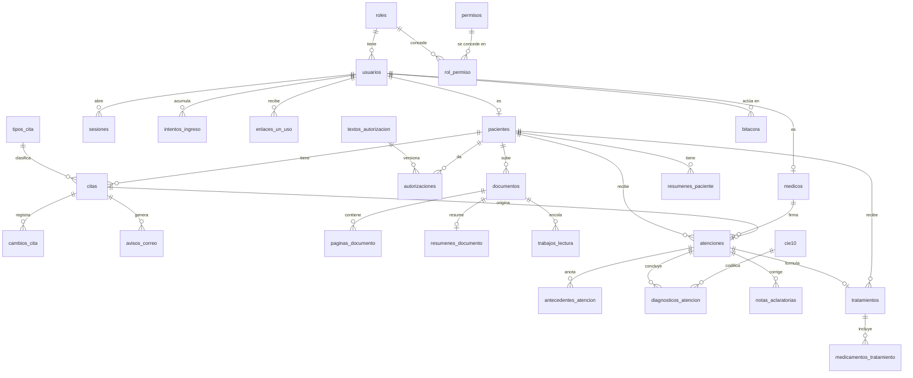

# Modelo de datos

**Fase del ciclo de vida:** Diseño
**Versión:** 1.1 · 13 de octubre de 2026

Base de datos PostgreSQL. Los nombres van en español y en minúsculas. Todas las fechas con hora se guardan en hora universal y se muestran en hora de Colombia.

La versión 1.1 incorpora las decisiones D-20 a D-24: ingreso con documento, corrección de datos e historia clínica del consultorio. También cierra los permisos por fila de todas las tablas.

---

## 1. Diagrama

Tablas sin relación en el diagrama: `consultorio`, `franjas_horario` y `bloqueos`, que pertenecen al único consultorio y al único médico; y los catálogos `municipios` y `listas_valores`.

## 2. Tablas

### Cuentas y permisos (E1)

| Tabla | Campos principales | Notas |
|---|---|---|
| `consultorio` | nombre, direccion, telefono, correo, anticipacion_horas, margen_agenda_minutos | Una sola fila. `anticipacion_horas` arranca en 24 y `margen_agenda_minutos` en 60 (supuestos S-03 y S-04) |
| `roles` | codigo, nombre | Dos filas: `medico` y `paciente` |
| `permisos` | codigo, descripcion | Una fila por operación de la API |
| `rol_permiso` | rol, permiso | La matriz de HU-006. Lo que no está aquí queda denegado |
| `usuarios` | id, tipo_documento, numero_documento, correo, hash_contrasena, rol, activo, creado_en | **Se ingresa con el documento** (D-20): la pareja tipo y número es única. El correo puede repetirse y puede faltar (S-15, S-22). `hash_contrasena` queda vacío hasta que el paciente activa su cuenta |
| `intentos_ingreso` | usuario_id, origen, fallos, ultimo_fallo, bloqueado_hasta | Cuenta los fallos por cuenta **y por equipo de origen**, para que un tercero no pueda bloquearle la cuenta a su dueño. `origen` es un resumen de la dirección de red, no la dirección |
| `medicos` | usuario_id, nombres, apellidos, registro_profesional | Una sola fila |
| `pacientes` | id, usuario_id, nombres, apellidos, fecha_nacimiento, telefono, registrado_por, y los datos de la historia clínica: sexo, estado_civil, ocupacion, direccion, municipio, aseguradora, tipo_vinculacion, responsable_nombre, responsable_telefono, responsable_parentesco | Los primeros se piden en el registro (D-21). Los de la historia clínica se llenan después, por el paciente o por el médico (HU-041), y son obligatorios para cerrar una atención. La fecha de nacimiento debe dar 18 años o más (D-22) |
| `sesiones` | id, usuario_id, hash_identificador, creada_en, ultima_actividad, vence_en, anulada_en | Se guarda el hash, nunca el identificador |
| `enlaces_un_uso` | id, usuario_id, tipo, hash_enlace, vence_en, usado_en | Tipos: `recuperacion`, `activacion`, `puesta_en_marcha`. El de puesta en marcha no tiene usuario todavía |
| `textos_autorizacion` | id, tipo, version, contenido, vigente_desde | Tipos: `datos` e `ia` |
| `autorizaciones` | id, paciente_id, texto_id, decision, fecha | Decisiones: `aceptada`, `rechazada`, `retirada`. Nunca se modifica una fila: cada cambio es una fila nueva |

Tipos de documento: `CC` cédula de ciudadanía, `CE` cédula de extranjería, `PA` pasaporte y `PT` permiso por protección temporal.

### Calendario y citas (E2, E3)

| Tabla | Campos principales | Notas |
|---|---|---|
| `franjas_horario` | id, dia_semana, hora_inicio, hora_fin, vigente_desde | Varias franjas por día. Una restricción impide que se crucen |
| `bloqueos` | id, inicio, fin, motivo | Un bloqueo de varios días es un solo rango |
| `tipos_cita` | id, nombre, duracion_minutos, activo | La duración de una cita ya creada no cambia si se edita el tipo |
| `citas` | id, paciente_id, tipo_cita_id, inicio, fin, estado, creada_por, fuera_de_horario, creado_en | Estados: `confirmada`, `cancelada`, `atendida`, `no_asistio` |
| `cambios_cita` | id, cita_id, usuario_id, tipo, inicio_anterior, inicio_nuevo, motivo, fecha | Tipos: `creada`, `movida`, `cancelada`, `asistencia`, `correccion`. Es lo que el paciente ve como historial de su cita |
| `avisos_correo` | id, cita_id, usuario_id, tipo, destinatario, asunto, cuerpo, estado, intentos, ultimo_error, enviado_en | El aviso se guarda ya redactado, sin información clínica. Así el proceso que envía no necesita leer citas ni pacientes. Tipos: `cita_creada`, `cita_movida`, `cita_cancelada`, `cambio_de_datos`. Estados: `pendiente`, `enviado`, `fallido`. `cita_id` falta en los avisos de cambio de datos |

**Regla contra choques.** La tabla `citas` tiene una restricción de exclusión sobre el rango de tiempo `[inicio, fin)` que aplica a las citas no canceladas. Si dos personas confirman el mismo espacio al tiempo, la base acepta una y rechaza la otra; la API convierte ese rechazo en el aviso de "espacio ocupado" con alternativas (HU-011, CA-2).

**Correos que no pasan por esta tabla.** Los de recuperación, activación y puesta en marcha llevan un enlace de un solo uso, que nunca se guarda en claro. Se envían directamente al terminar la petición.

### Documentos y asistente (E5, E6)

| Tabla | Campos principales | Notas |
|---|---|---|
| `documentos` | id, paciente_id, nombre, fecha_documento, tipo, formato, tamano, huella, clave_archivo, estado_lectura, paginas, subido_en | Tipos: `historia_clinica`, `examen`, `formula`, `imagen`, `otro`. Estados de lectura: `sin_leer`, `en_proceso`, `legible`, `no_legible`. `huella` es el resumen del contenido: si el paciente sube dos veces el mismo archivo, se detecta |
| `paginas_documento` | documento_id, numero, texto, origen, legibilidad | `origen` dice si el texto venía en el PDF o se reconoció de una imagen |
| `resumenes_documento` | documento_id, resumen, generado_en | Se usa cuando los documentos de un paciente no caben completos en una consulta |
| `trabajos_lectura` | id, documento_id, estado, intentos, error, creado_en | Cola del lector. Estados: `pendiente`, `en_curso`, `hecho`, `fallido` |
| `resumenes_paciente` | id, paciente_id, contenido, generado_en, desactualizado | `contenido` guarda las secciones del resumen con el origen de cada punto |

**Eliminación.** Cuando el paciente elimina un documento se borran el archivo, sus páginas, su resumen y sus trabajos pendientes, y el resumen del paciente queda marcado como desactualizado. En la bitácora queda el hecho, sin el contenido.

Las preguntas y respuestas del asistente **no se guardan**. La conversación vive en la pantalla mientras el médico la tiene abierta; en la bitácora solo queda quién preguntó, sobre qué paciente y cuándo.

### Historia clínica del consultorio (E9)

Cada campo corresponde a una fila de la sección 4 del [marco normativo](../planificacion/03-marco-normativo.md).

| Tabla | Campos principales | Notas |
|---|---|---|
| `atenciones` | id, paciente_id, medico_id, cita_id, estado, inicio, fin | Estados: `abierta` y `cerrada`. Una atención abierta es el borrador. Un índice impide que un paciente tenga dos abiertas (HU-042, CA-6). `cita_id` falta si se abrió desde la ficha |
| | tipo_consulta, finalidad, causa, acompanante_nombre, acompanante_telefono | Datos de la consulta |
| | motivo, enfermedad_actual, revision_sistemas, examen_fisico, plan | Texto |
| | tension_sistolica, tension_diastolica, frecuencia_cardiaca, frecuencia_respiratoria, temperatura, peso, talla | Signos vitales, con rangos válidos. El índice de masa corporal se calcula, no se guarda |
| | ordenes, incapacidad_dias, destino, remitido_a | Texto libre para las órdenes (S-18) |
| | cerrada_en, firma_nombre, firma_registro, firma_documento | Se llenan al cerrar: son la copia del nombre, el registro y el documento del médico en ese momento |
| `antecedentes_atencion` | atencion_id, clase, tipo, descripcion, parentesco | Clases: `personal`, `familiar`, `alergia`, `factor_de_riesgo`. `tipo` es el tipo de alergia o de factor de riesgo; `parentesco` solo aplica a los familiares. Si no hay nada que anotar en una clase, se guarda una fila "no refiere" |
| `diagnosticos_atencion` | atencion_id, orden, codigo_cie10, tipo, principal | Tipos: `impresion_diagnostica`, `confirmado_nuevo`, `confirmado_repetido`. Uno solo es el principal |
| `notas_aclaratorias` | id, atencion_id, medico_id, texto, fecha, firma_nombre, firma_registro | Solo inserción. Es la única forma de corregir una atención cerrada |
| `cie10` | codigo, nombre | Catálogo de diagnósticos, cargado desde la tabla oficial |
| `municipios` | codigo, nombre, departamento | Catálogo de municipios de Colombia |
| `listas_valores` | lista, codigo, nombre, activo | Listas cortas tomadas de las tablas de referencia oficiales: sexo, estado civil, tipo de vinculación, tipo de consulta, finalidad, causa, tipo de alergia, tipo de factor de riesgo, parentesco y destino |

**Lo cerrado no cambia.** Un disparador en la base rechaza cualquier modificación o borrado de una atención cerrada, de sus antecedentes y de sus diagnósticos. El usuario de la API tampoco tiene permiso de borrar en estas tablas. Es la regla del artículo 18 de la Resolución 1995 de 1999 (HU-044, CA-3; RNF-15).

**Antecedentes de una atención a la siguiente.** Al abrir una atención nueva, la API copia como punto de partida los antecedentes de la última cerrada. El médico los confirma o los cambia; la atención anterior no se toca (HU-043, CA-5).

### Tratamientos (E8)

| Tabla | Campos principales | Notas |
|---|---|---|
| `tratamientos` | id, paciente_id, medico_id, atencion_id, fecha, motivo, indicaciones, creado_en | Solo inserción: un tratamiento guardado no se modifica ni se borra. `atencion_id` lo une a la atención en que se formuló; falta si se registró desde la ficha |
| `medicamentos_tratamiento` | tratamiento_id, orden, nombre, dosis, via, frecuencia, dias, modo | `via` es la vía de administración, que pide la Resolución 866. `modo` es la forma de tomarlo que ve el paciente. El nombre va en texto libre |

La fecha de fin y el estado (vigente o terminado) no se guardan: se calculan con la fecha del tratamiento y la duración más larga de sus medicamentos.

### Bitácora (E7)

| Tabla | Campos principales | Notas |
|---|---|---|
| `bitacora` | id, fecha, usuario_id, rol, paciente_id, accion, objeto, detalle | Solo inserción. `detalle` no lleva contenido clínico |

Acciones que se registran: ingreso y salida, acceso denegado, apertura de ficha, emisión de enlace de documento, carga y eliminación de documento, consulta al asistente, generación de resumen, creación, movimiento y cancelación de cita, cambio de asistencia, registro de tratamiento, cambio de autorización, corrección de datos de un paciente con el valor anterior y el nuevo, apertura y cierre de atención, nota aclaratoria, consulta de la historia clínica y generación de copia.

## 3. Permisos por fila

### 3.1 Cómo sabe la base quién pregunta

La API se conecta con un usuario de base de datos, `vitalia_api`, que **no** es dueño de las tablas y no puede saltarse las políticas. Al abrir cada transacción le indica a la base dos datos que valen solo para esa transacción: el usuario y la identidad. Las políticas leen esos datos.

| Identidad | Cuándo se usa |
|---|---|
| `paciente` | Petición con la sesión de un paciente |
| `medico` | Petición con la sesión del médico |
| `sistema` | Procesos en segundo plano: el lector de documentos y el envío de avisos. No tiene usuario |
| Ninguna | Peticiones sin sesión. Sin identidad, ninguna política deja pasar filas |

**Qué protege y qué no.** Los permisos por fila protegen de un error de programación: una consulta que olvida filtrar no devuelve filas ajenas. No protegen si alguien toma control de la API, porque es la API la que declara la identidad. Para eso están las demás medidas: claves fuera del código, bitácora y respaldo.

### 3.2 Lo que pasa sin sesión

El ingreso, el registro, la recuperación, la activación, la puesta en marcha y la búsqueda de la sesión de cada petición ocurren **antes** de saber quién es el usuario. Como sin identidad no se ve ninguna fila, cada una se hace con una función de la base que tiene permiso propio y hace una sola cosa:

| Función | Qué hace | Qué devuelve |
|---|---|---|
| `buscar_credencial` | Busca una cuenta por tipo y número de documento | El hash de la contraseña, el rol y si está bloqueada desde ese origen. Nada más |
| `anotar_intento` | Suma o reinicia los fallos de una cuenta desde un origen | — |
| `abrir_sesion` | Crea la sesión de un usuario ya verificado | — |
| `sesion_vigente` | Busca una sesión por su hash y renueva la última actividad, como mucho una vez por minuto | El usuario y su rol |
| `registrar_paciente` | Crea la cuenta, el paciente y su autorización de datos, validando documento único y mayoría de edad | El usuario creado |
| `usar_enlace` | Marca como usado un enlace vigente y aplica su efecto: contraseña nueva, activación o puesta en marcha | El usuario |
| `texto_vigente` | Devuelve el texto vigente de una autorización | El texto |

`vitalia_api` solo puede ejecutar estas funciones; no puede leer `usuarios` ni `sesiones` sin identidad.

**Accesos denegados.** Cuando se niega una operación, su transacción se deshace. El registro del intento se escribe en la bitácora en una transacción aparte, para que no se pierda (HU-006, CA-2; HU-027, CA-3).

### 3.3 Qué puede hacer cada identidad

| Tabla | Paciente | Médico | Sistema |
|---|---|---|---|
| `usuarios` | Lee su fila; cambia su correo | Lee todas; corrige las de los pacientes (HU-040) | — |
| `pacientes` | Lee su fila; cambia su teléfono y sus datos de la historia clínica | Lee, crea y corrige todas | — |
| `medicos`, `consultorio` | Solo lectura | Lee y edita | — |
| `intentos_ingreso` | — | — | — |
| `sesiones`, `enlaces_un_uso` | Solo las propias | Solo las propias | — |
| `textos_autorizacion` | Solo lectura | Solo lectura | — |
| `autorizaciones` | Lee e inserta las suyas | Lee todas | Lee, para saber si puede leer una foto |
| `citas`, `cambios_cita` | Lee y crea las suyas | Lee y crea todas | — |
| `avisos_correo` | Inserta los de sus propios cambios | Lee e inserta | Lee y actualiza el estado |
| `franjas_horario`, `bloqueos`, `tipos_cita` | Solo lectura de lo necesario para agendar | Lee y edita | — |
| `documentos`, `paginas_documento` | Lee, crea y elimina los suyos | Lee todos; no crea ni elimina | Lee, actualiza el estado de lectura e inserta páginas |
| `trabajos_lectura` | Inserta al subir un documento | Lee | Lee y actualiza |
| `resumenes_documento`, `resumenes_paciente` | — | Lee y crea | Crea los resúmenes por documento |
| `atenciones`, `antecedentes_atencion`, `diagnosticos_atencion` | — | Lee todas; crea; edita solo las abiertas | — |
| `notas_aclaratorias` | — | Lee e inserta | — |
| `tratamientos`, `medicamentos_tratamiento` | Lee los suyos | Lee y crea; nadie modifica ni borra | — |
| `bitacora` | Solo inserta | Lee e inserta | Solo inserta |
| `roles`, `permisos`, `rol_permiso`, `cie10`, `municipios`, `listas_valores` | Solo lectura | Solo lectura | Solo lectura |

"—" significa sin acceso. En esta versión el paciente no ve su historia clínica desde su cuenta; el médico le entrega copia (HU-046).

### 3.4 Reglas de implementación

1. `vitalia_api` no es dueño de las tablas. Las migraciones corren con otro usuario, que sí lo es y que la aplicación nunca usa.
2. Toda tabla de la sección 3.3 tiene los permisos por fila **forzados**.
3. Una prueba automática recorre el catálogo de la base y **hace fallar el despliegue** si una tabla no tiene política, o si tiene una que deja pasar todo sin estar en la lista de catálogos de la última fila de la sección 3.3 (HU-036, CA-4).
4. Las funciones de la sección 3.2 se prueban una por una: lo que devuelven y, sobre todo, lo que no devuelven.

## 4. Índices principales

| Tabla | Índice | Para qué |
|---|---|---|
| `usuarios` | único por `tipo_documento` y `numero_documento` | Ingreso y registro |
| `citas` | por `inicio` | Agenda del día y calendario |
| `citas` | por `paciente_id` e `inicio` | "Mis citas" |
| `pacientes` | por nombre, sin tildes ni mayúsculas | Búsqueda del médico |
| `documentos` | por `paciente_id`; único por `paciente_id` y `huella` | Ficha, "Mis documentos" y documento repetido |
| `atenciones` | por `paciente_id` y `cerrada_en`; único por `paciente_id` cuando está abierta | Historial y una sola atención abierta |
| `cie10` | por código y por nombre, sin tildes | Buscador de diagnósticos |
| `bitacora` | por `paciente_id` y `fecha` | Consulta de la bitácora |
| `trabajos_lectura`, `avisos_correo` | por `estado` | Colas en segundo plano |

## 5. Trazabilidad con las historias

| Historia | Tablas que toca |
|---|---|
| HU-001 | `consultorio`, `usuarios`, `medicos`, `enlaces_un_uso` |
| HU-002, HU-024 | `usuarios`, `pacientes`, `enlaces_un_uso` |
| HU-003, HU-032 | `textos_autorizacion`, `autorizaciones` |
| HU-004, HU-005, HU-007 | `usuarios`, `sesiones`, `intentos_ingreso`, `enlaces_un_uso` |
| HU-006 | `roles`, `permisos`, `rol_permiso` |
| HU-008, HU-009, HU-010 | `franjas_horario`, `bloqueos`, `tipos_cita` |
| HU-011 a HU-018, HU-020 a HU-022 | `citas`, `cambios_cita` |
| HU-019 | `avisos_correo` |
| HU-023, HU-025, HU-026 | `pacientes`, `citas`, `documentos`, `tratamientos`, `atenciones`. HU-026 no toca tablas |
| HU-027 a HU-031 | `documentos`, `paginas_documento`, `trabajos_lectura` |
| HU-033 a HU-035 | `paginas_documento`, `resumenes_documento`, `resumenes_paciente` |
| HU-036 | Políticas y funciones de la sección 3 |
| HU-037 | `bitacora` |
| HU-038, HU-039 | `tratamientos`, `medicamentos_tratamiento` |
| HU-040 | `usuarios`, `pacientes`, `avisos_correo`, `bitacora` |
| HU-041 | `pacientes`, `municipios`, `listas_valores` |
| HU-042, HU-043 | `atenciones`, `antecedentes_atencion`, `diagnosticos_atencion`, `cie10`, `listas_valores`, `tratamientos` |
| HU-044 | `atenciones`, `notas_aclaratorias`, `citas` |
| HU-045, HU-046 | `atenciones` y sus tablas, solo lectura |
