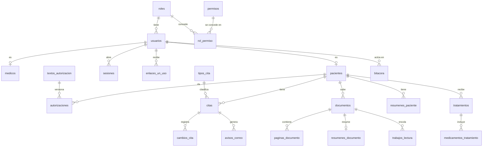

# Modelo de datos

**Fase del ciclo de vida:** Diseño
**Versión:** 1.0 · 12 de octubre de 2026

Base de datos PostgreSQL. Los nombres van en español y en minúsculas. Todas las fechas con hora se guardan en hora universal y se muestran en hora de Colombia.

---

## 1. Diagrama

Tablas sin relación en el diagrama: `consultorio`, `franjas_horario` y `bloqueos`. Pertenecen al único consultorio y al único médico del sistema.

## 2. Tablas

### Cuentas y permisos (E1)

| Tabla | Campos principales | Notas |
|---|---|---|
| `consultorio` | nombre, direccion, telefono, correo, anticipacion_horas, margen_agenda_minutos | Una sola fila. `anticipacion_horas` arranca en 24 y `margen_agenda_minutos` en 60 (supuestos S-03 y S-04) |
| `roles` | codigo, nombre | Dos filas: `medico` y `paciente` |
| `permisos` | codigo, descripcion | Una fila por operación de la API |
| `rol_permiso` | rol, permiso | La matriz de HU-006. Lo que no está aquí queda denegado |
| `usuarios` | id, correo, hash_contrasena, rol, activo, intentos_fallidos, bloqueado_hasta, creado_en | `correo` es único. `hash_contrasena` queda vacío hasta que el paciente activa su cuenta |
| `medicos` | usuario_id, nombre, registro_profesional | Una sola fila |
| `pacientes` | id, usuario_id, tipo_documento, numero_documento, nombres, apellidos, fecha_nacimiento, celular, registrado_por | Documento único por tipo y número. `registrado_por` dice si se registró solo o lo registró el médico |
| `sesiones` | id, usuario_id, hash_identificador, creada_en, ultima_actividad, vence_en, anulada_en | Se guarda el hash, nunca el identificador |
| `enlaces_un_uso` | id, usuario_id, tipo, hash_enlace, vence_en, usado_en | Tipos: `recuperacion`, `activacion`, `puesta_en_marcha` |
| `textos_autorizacion` | id, tipo, version, contenido, vigente_desde | Tipos: `datos` e `ia` |
| `autorizaciones` | id, paciente_id, texto_id, decision, fecha | Decisiones: `aceptada`, `rechazada`, `retirada`. Nunca se modifica una fila: cada cambio es una fila nueva |

### Calendario y citas (E2, E3)

| Tabla | Campos principales | Notas |
|---|---|---|
| `franjas_horario` | id, dia_semana, hora_inicio, hora_fin, vigente_desde | Varias franjas por día. Una restricción impide que se crucen |
| `bloqueos` | id, inicio, fin, motivo | Un bloqueo de varios días es un solo rango |
| `tipos_cita` | id, nombre, duracion_minutos, activo | La duración de una cita ya creada no cambia si se edita el tipo |
| `citas` | id, paciente_id, tipo_cita_id, inicio, fin, estado, creada_por, fuera_de_horario, creado_en | Estados: `confirmada`, `cancelada`, `atendida`, `no_asistio` |
| `cambios_cita` | id, cita_id, usuario_id, tipo, inicio_anterior, inicio_nuevo, motivo, fecha | Tipos: `creada`, `movida`, `cancelada`, `asistencia`, `correccion`. Es lo que el paciente ve como historial de su cita |
| `avisos_correo` | id, cita_id, tipo, estado, intentos, ultimo_error, enviado_en | Estados: `pendiente`, `enviado`, `fallido` |

**Regla contra choques.** La tabla `citas` tiene una restricción de exclusión sobre el rango de tiempo `[inicio, fin)` que aplica a las citas no canceladas. Si dos personas confirman el mismo espacio al tiempo, la base acepta una y rechaza la otra; la API convierte ese rechazo en el aviso de "espacio ocupado" con alternativas (HU-011, CA-2).

### Documentos y asistente (E5, E6)

| Tabla | Campos principales | Notas |
|---|---|---|
| `documentos` | id, paciente_id, nombre, fecha_documento, tipo, formato, tamano, clave_archivo, estado_lectura, paginas, subido_en | Tipos: `historia_clinica`, `examen`, `formula`, `imagen`, `otro`. Estados de lectura: `sin_leer`, `en_proceso`, `legible`, `no_legible` |
| `paginas_documento` | documento_id, numero, texto, origen, legibilidad | `origen` dice si el texto venía en el PDF o se reconoció de una imagen |
| `resumenes_documento` | documento_id, resumen, generado_en | Se usa cuando los documentos de un paciente no caben completos en una consulta |
| `trabajos_lectura` | id, documento_id, estado, intentos, error, creado_en | Cola del lector. Estados: `pendiente`, `en_curso`, `hecho`, `fallido` |
| `resumenes_paciente` | id, paciente_id, contenido, generado_en, desactualizado | `contenido` guarda las secciones del resumen con el origen de cada punto |

**Eliminación.** Cuando el paciente elimina un documento se borran el archivo, sus páginas, su resumen y sus trabajos pendientes, y el resumen del paciente queda marcado como desactualizado. En la bitácora queda el hecho, sin el contenido.

Las preguntas y respuestas del asistente **no se guardan**. La conversación vive en la pantalla mientras el médico la tiene abierta; en la bitácora solo queda quién preguntó, sobre qué paciente y cuándo.

### Tratamientos (E8)

| Tabla | Campos principales | Notas |
|---|---|---|
| `tratamientos` | id, paciente_id, medico_id, fecha, motivo, indicaciones, creado_en | Solo inserción: un tratamiento guardado no se modifica ni se borra |
| `medicamentos_tratamiento` | tratamiento_id, orden, nombre, dosis, frecuencia, dias, modo | `modo` es la forma de tomarlo que ve el paciente. El nombre va en texto libre |

La fecha de fin y el estado (vigente o terminado) no se guardan: se calculan con la fecha del tratamiento y la duración más larga de sus medicamentos.

### Bitácora (E7)

| Tabla | Campos principales | Notas |
|---|---|---|
| `bitacora` | id, fecha, usuario_id, rol, paciente_id, accion, objeto, detalle | Solo inserción. `detalle` no lleva contenido clínico |

Acciones que se registran: ingreso y salida, acceso denegado, apertura de ficha, emisión de enlace de documento, carga y eliminación de documento, consulta al asistente, generación de resumen, creación, movimiento y cancelación de cita, cambio de asistencia, registro de tratamiento, cambio de autorización.

## 3. Permisos por fila

La API abre cada transacción indicando a la base el usuario y el rol de la sesión. Las políticas usan ese dato.

| Tabla | Paciente | Médico |
|---|---|---|
| `pacientes` | Lee y edita solo su fila | Lee y crea todas |
| `autorizaciones` | Lee e inserta las suyas | Lee todas |
| `citas`, `cambios_cita` | Lee y crea las suyas | Lee y crea todas |
| `documentos`, `paginas_documento` | Lee, crea y elimina los suyos | Lee todos; no crea ni elimina |
| `resumenes_documento`, `resumenes_paciente` | Sin acceso | Lee y crea |
| `tratamientos`, `medicamentos_tratamiento` | Lee los suyos | Lee y crea; nadie modifica ni borra |
| `franjas_horario`, `bloqueos`, `tipos_cita` | Solo lectura de lo necesario para agendar | Lee y edita |
| `bitacora` | Sin acceso | Solo lectura |
| `sesiones`, `enlaces_un_uso` | Solo las propias | Solo las propias |

Tres reglas de implementación:

1. La API se conecta con un usuario que **no** es dueño de las tablas y no puede saltarse las políticas.
2. Toda tabla de esta lista tiene los permisos por fila **forzados**.
3. Una prueba automática recorre el catálogo de la base y **hace fallar el despliegue** si alguna tabla con datos de salud no tiene política o tiene una que deja pasar todo (HU-036, CA-4).

## 4. Índices principales

| Tabla | Índice | Para qué |
|---|---|---|
| `citas` | por `inicio` | Agenda del día y calendario |
| `citas` | por `paciente_id` e `inicio` | "Mis citas" |
| `pacientes` | por nombre y por documento | Búsqueda del médico |
| `documentos` | por `paciente_id` | Ficha y "Mis documentos" |
| `bitacora` | por `paciente_id` y `fecha` | Consulta de la bitácora |
| `trabajos_lectura` | por `estado` | Cola del lector |

## 5. Trazabilidad con las historias

| Historia | Tablas que toca |
|---|---|
| HU-001 | `consultorio`, `usuarios`, `medicos`, `enlaces_un_uso` |
| HU-002, HU-024 | `usuarios`, `pacientes`, `enlaces_un_uso` |
| HU-003, HU-032 | `textos_autorizacion`, `autorizaciones` |
| HU-004, HU-005, HU-007 | `usuarios`, `sesiones`, `enlaces_un_uso` |
| HU-006 | `roles`, `permisos`, `rol_permiso` |
| HU-008, HU-009, HU-010 | `franjas_horario`, `bloqueos`, `tipos_cita` |
| HU-011 a HU-018, HU-020 a HU-022 | `citas`, `cambios_cita` |
| HU-019 | `avisos_correo` |
| HU-023, HU-025 | `pacientes`, `citas`, `documentos` |
| HU-027 a HU-031 | `documentos`, `paginas_documento`, `trabajos_lectura` |
| HU-033 a HU-035 | `paginas_documento`, `resumenes_documento`, `resumenes_paciente` |
| HU-036 | Políticas de todas las tablas de la sección 3 |
| HU-037 | `bitacora` |
| HU-038, HU-039 | `tratamientos`, `medicamentos_tratamiento` |
