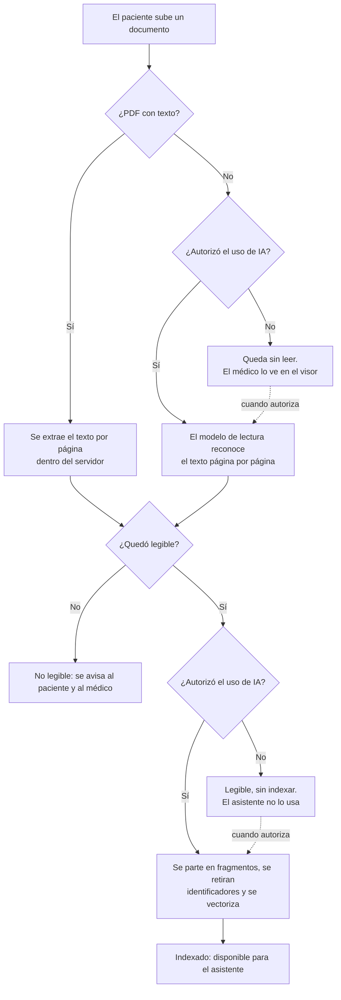
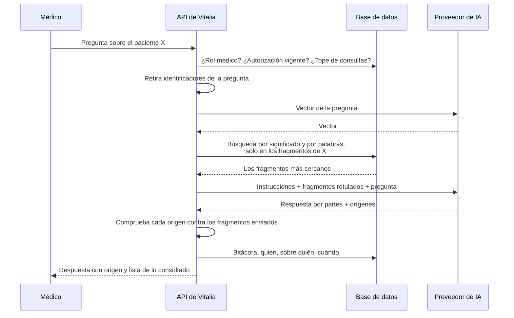

# Asistente de IA

**Fase del ciclo de vida:** Diseño
**Versión:** 2.0 · 26 de octubre de 2026 (búsqueda de fragmentos, D-30)

Cómo el médico le pregunta al asistente sobre los documentos y las atenciones de un paciente (HU-031 a HU-035), cómo se buscan los fragmentos que responden y con qué proveedor.

---

## 1. Proveedor

La idea del dueño del proyecto es arrancar con un modelo chino económico (DeepSeek o Qwen) para tener una primera versión rápido, y pasar después a una API empresarial.

| | DeepSeek (API directa) | Qwen (Alibaba Cloud, plataforma internacional) |
|---|---|---|
| Forma de conectarse | Compatible con el formato de OpenAI | Compatible con el formato de OpenAI |
| Texto que admite por consulta | Hasta 1 millón de unidades de texto | Hasta 1 millón en `qwen-plus`, según su documentación; hay fuentes que dan menos |
| Lectura de fotos y escaneados | Solo un modelo experimental que reduce cada imagen a muy poco detalle | Sí, con un modelo dedicado a reconocer texto (`qwen-vl-ocr`) |
| Precio aproximado por millón | 0,14 a 0,30 USD de entrada; 0,28 a 1,20 de salida | 0,40 USD de entrada; 1,20 de salida |
| Dónde quedan los datos | En servidores en China | Se puede elegir Singapur o Estados Unidos |
| Uso de los datos para entrenar | Sí por defecto, según análisis de terceros; sin exclusión clara para la API | Su aviso de privacidad dice que no, según fuentes de terceros; por confirmar |

**Decisión: Qwen para la primera versión.** Tres razones:

1. Un solo proveedor cubre las dos tareas: leer fotos y escaneados, y responder preguntas. Con DeepSeek haría falta otro servicio para la lectura.
2. Permite que los datos no queden en China continental.
3. Sus condiciones de uso de datos son más favorables, aunque falta confirmarlas en el contrato.

DeepSeek sale un poco más barato, pero la diferencia es de fracciones de centavo por pregunta y no compensa lo anterior.

> **Límite de la primera versión.** Con cualquiera de los dos, el sistema se prueba **solo con documentos inventados o anonimizados**. Para cargar documentos de pacientes reales hacen falta dos cosas: la respuesta del abogado a la pregunta 2 del [marco normativo](../planificacion/03-marco-normativo.md) y un contrato de tratamiento de datos con el proveedor. Enviar historias clínicas reales a DeepSeek directo no es defendible frente a la Ley 1581.

**Camino hacia la API empresarial.** Como los dos usan el formato de OpenAI, el cambio de proveedor es de configuración: dirección, clave y nombre del modelo. Una opción que conserva los mismos modelos es Amazon Bedrock, que ofrece DeepSeek y Qwen con el compromiso de no compartir los datos con el fabricante ni usarlos para entrenar.

## 2. El adaptador

Todo el sistema habla con una sola pieza interna, el adaptador de IA, que tiene tres funciones: **leer una página** (imagen a texto), **vectorizar** (texto a vector, para la búsqueda) y **responder** (texto a texto). El adaptador es el único lugar que conoce al proveedor.

| Variable de configuración | Qué define |
|---|---|
| `IA_DIRECCION` | Dirección del proveedor |
| `IA_CLAVE` | Clave de acceso. Vive solo en el servidor |
| `IA_MODELO_RESPUESTAS` | Modelo para preguntas y resúmenes |
| `IA_MODELO_LECTURA` | Modelo para reconocer texto en imágenes |
| `IA_MODELO_VECTORES` | Modelo que convierte cada fragmento y cada pregunta en un vector: `qwen3.7-text-embedding` |
| `IA_DIMENSIONES` | Tamaño de cada vector: 1.024, el valor por defecto del modelo |
| `IA_TOPE_CONTEXTO` | Máximo de texto que se envía en una consulta |
| `IA_TOPE_CONSULTAS_HORA` | Máximo de consultas por hora |

**Cambiar el modelo de vectores obliga a volver a indexar.** Los vectores de dos modelos distintos no se pueden comparar. Cada fragmento guarda el nombre del modelo con que se vectorizó; si la configuración cambia, una tarea vuelve a vectorizar todos los fragmentos antes de que el asistente responda con el modelo nuevo.

## 3. Qué textos consulta el asistente

Desde la versión 2.0 el asistente usa **búsqueda de fragmentos** (RAG, por sus siglas en inglés): en cada pregunta busca los trozos de texto que más se parecen a ella y le envía al modelo solo esos. Busca en dos fuentes, siempre de **un solo paciente**:

| Fuente | Qué entra | Cómo se cita |
|---|---|---|
| Documentos que subió el paciente (E5) | Las páginas legibles | `[D2, pág. 1]`: documento y página |
| Atenciones del consultorio (E9) | Solo las **cerradas** y sus notas aclaratorias. Una atención abierta es un borrador y no entra | `[A3]`: la atención, que en pantalla se muestra con su fecha |

Lo que no entra: los tratamientos (lo que se formuló ya está en el plan de la atención), las citas, los datos de identificación y cualquier cosa de otro paciente.

**Autorización.** Para vectorizar, el texto se envía al proveedor. Por eso **nada se indexa sin la autorización de IA del paciente**, tampoco el texto de un PDF que se leyó dentro del servidor. Las atenciones solo entran si la versión de la autorización que aceptó el paciente las menciona: el texto de la versión 1 habla solo de "sus documentos", así que hace falta una versión 2 que incluya las atenciones (borrador para el abogado) y que el paciente la acepte. Mientras tenga la versión 1, el asistente consulta solo sus documentos y el médico lo ve indicado.

## 4. Lectura e indexación de documentos (HU-031)

- **Legible** significa que la página trae una cantidad mínima de texto reconocible. El umbral se ajusta con la prueba de concepto 1 de la [arquitectura](01-arquitectura.md).
- **Fragmentos.** Cada página se parte en trozos de unos 1.000 caracteres, cortando en fin de párrafo o de frase, con unos 150 caracteres repetidos entre un trozo y el siguiente para no partir un dato en dos. **Un fragmento nunca cruza de una página a otra**: así cada uno sabe exactamente de qué página salió.
- **Antes de vectorizar** se reemplazan por rótulos el nombre del paciente, su número de documento, su celular y su correo, igual que antes de preguntar. El fragmento se guarda ya con los rótulos.
- Cuando el paciente **autoriza** la IA, los documentos sin leer entran a la cola de lectura y los legibles a la de indexación.
- Cuando **retira** la autorización, no se lee ni se indexa nada más, el asistente se deshabilita y **se borran sus fragmentos y vectores**. El texto ya leído por página se conserva hasta que elimine el documento, para el visor.
- Cuando **elimina** un documento, se borran también sus fragmentos.

### 4.1 Indexación de las atenciones

Al cerrar y firmar una atención (HU-044) se encola su indexación. Una atención se parte por secciones del formulario, no por tamaño, porque cada sección ya es una unidad con sentido:

| Fragmento | Qué lleva |
|---|---|
| Motivo y enfermedad actual | `motivo`, `enfermedad_actual` |
| Antecedentes | Personales, familiares, alergias y factores de riesgo, con "no refiere" cuando así se registró |
| Revisión y examen | `revision_sistemas`, signos vitales en texto y `examen_fisico` |
| Diagnósticos | Código y nombre CIE-10, tipo y cuál es el principal |
| Plan | `plan`, órdenes, incapacidad, destino y remisión |
| Nota aclaratoria | Una por nota, con su fecha. Se indexa al guardarla |

Cada fragmento empieza con la fecha de la atención, para que el modelo pueda ordenar por fecha. Una atención cerrada no cambia (RNF-15), así que sus fragmentos tampoco: solo se agregan los de las notas aclaratorias.

## 5. Una pregunta, paso a paso (HU-033, HU-034)

### 5.1 La búsqueda

Se hacen dos búsquedas sobre los fragmentos del paciente y se combinan:

| Búsqueda | Qué encuentra bien | Cómo |
|---|---|---|
| Por significado | Preguntas dichas con otras palabras: "¿tiene problemas del corazón?" encuentra "insuficiencia cardíaca" | Distancia entre el vector de la pregunta y el de cada fragmento, con `pgvector` |
| Por palabras | Nombres de medicamentos, siglas, códigos CIE-10 y cifras, que la búsqueda por significado confunde | Búsqueda de texto completo de PostgreSQL en español, sin tildes |

Cada búsqueda trae sus 20 mejores fragmentos; se combinan por su posición en las dos listas (fusión por rango recíproco) y se quedan los 12 primeros, sin pasar de `IA_TOPE_CONTEXTO`. Los números 20 y 12 son el punto de partida y se ajustan con el conjunto de prueba de la sección 8.

- **Siempre filtrada por paciente.** La búsqueda es una función de la base que recibe el identificador del paciente; además, los permisos por fila impiden leer fragmentos de otro aunque el código tenga un error.
- **Búsqueda exacta, sin índice aproximado.** Un paciente tiene cientos de fragmentos, no millones: se comparan todos los suyos, lo que es rápido y nunca deja uno por fuera. El índice aproximado de `pgvector` se agrega solo si una medición lo pide (D-19).
- **Paciente pequeño.** Si todos los fragmentos del paciente caben dentro de `IA_TOPE_CONTEXTO`, se envían todos y la búsqueda solo ordena. Así, con pocos documentos, una búsqueda que falle no puede dejar fuera la respuesta.
- **Preguntas que siguen la conversación.** "¿Y la dosis?" no se entiende sola. Para buscar se usan la pregunta actual y la anterior juntas; al modelo se le envía la conversación completa, como antes.

### 5.2 Armado del contexto

Los fragmentos encontrados se agrupan por fuente y se ordenan por fecha. Cada documento lleva su etiqueta (D1, D2…), su nombre y su fecha, y cada fragmento su página; cada atención lleva su etiqueta (A1, A2…) y su fecha. Las etiquetas se asignan en cada consulta y el servidor guarda a qué documento o atención corresponde cada una.

### 5.3 Instrucciones fijas del asistente

> Eres un asistente que ayuda a un médico a consultar los documentos que entregó un paciente y las atenciones registradas en el consultorio.
> 1. Responde únicamente con lo que está escrito en los fragmentos que recibes.
> 2. Después de cada dato indica su origen con la etiqueta, la página y la frase exacta entre comillas, así: [D2, pág. 1: "frase copiada"] para un documento o [A3: "frase copiada"] para una atención.
> 3. Si la información no aparece en los fragmentos, responde "No lo encontré en los documentos ni en las atenciones". No supongas ni completes.
> 4. No des diagnósticos ni recomiendes tratamientos. Si te lo piden, aclara que solo resumes lo registrado.
> 5. Si dos fragmentos se contradicen, muestra ambos datos con su origen.
> 6. Responde en español, de forma breve y en orden de fecha.

La regla 2 pide la frase dentro de la misma cita (27 de octubre, al construir): así el servidor sabe sin adivinar qué frase va con qué origen. Las instrucciones construidas están en `servidor/vitalia/dominio/asistente.py`, con una regla 7 que le dice al modelo que no intente adivinar los rótulos [PACIENTE], [DOCUMENTO], [TELÉFONO] y [CORREO].

La regla 3 cambió de "no aparece en los documentos" a "no lo encontré": con búsqueda de fragmentos, el modelo solo ve una parte, y la respuesta tiene que decirlo con honestidad.

### 5.4 Comprobación de los orígenes

El modelo puede equivocarse al citar. Por eso el servidor comprueba cada origen antes de mostrarlo:

| Comprobación | Si falla |
|---|---|
| El origen citado está entre los fragmentos que se enviaron en esta consulta, y es del paciente | El origen se descarta |
| La frase citada aparece en el texto de ese fragmento | El dato se muestra marcado como "origen sin verificar" |

Cada origen verificado es un enlace: el de un documento abre el visor en esa página con la frase resaltada (HU-034, CA-2); el de una atención abre esa atención en la historia clínica (HU-045).

**Lo consultado, a la vista.** Debajo de cada respuesta el médico ve la lista de documentos, páginas y atenciones que el asistente recibió. Si busca algo que sabe que está en otro documento, sabe que la búsqueda no lo trajo y puede abrirlo en el visor.

### 5.5 Conversación

Las preguntas siguientes de la misma sesión envían también los turnos anteriores, para que el asistente mantenga el hilo. La conversación no se guarda en la base de datos: se pierde al cerrar la ficha.

### 5.6 Dentro de la pantalla de atención

Cuando el médico atiende (HU-042), el asistente aparece a un lado del formulario de la historia clínica: muestra el resumen del paciente y admite preguntas, con las mismas operaciones y las mismas reglas de esta sección. **El asistente no escribe la historia clínica.** No existe ninguna operación que pase su texto al formulario; lo que queda registrado lo escribe el médico.

La atención que se está registrando no entra a la búsqueda mientras esté abierta: el médico la tiene delante, y un borrador no es fuente.

## 6. Resumen del paciente (HU-035)

El resumen tiene que estar **completo**, y una búsqueda de fragmentos no garantiza traerlo todo. Por eso el resumen no usa la búsqueda: se arma en dos pasos.

1. **Un resumen por documento**, generado una vez cuando el documento queda indexado (`resumenes_documento`), con el origen de cada punto.
2. **El resumen del paciente**: una sola consulta con los resúmenes de todos sus documentos más los datos ya estructurados de sus atenciones cerradas (diagnósticos CIE-10, antecedentes y alergias, y el plan de la última).

El resultado se guarda con su fecha, para no generarlo en cada visita.

| Sección | Contenido |
|---|---|
| Diagnósticos | Con fecha y origen |
| Procedimientos | Cirugías, exámenes invasivos, hospitalizaciones |
| Tratamientos y medicamentos | Nombre, dosis y periodo, si aparecen |
| Alergias | O "no aparece en los documentos ni en las atenciones" |
| Estado más reciente | Lo último registrado, con su fecha |

Las secciones siguen los grupos de datos clínicos relevantes de la Resolución 866 de 2021. Cuando el paciente sube o elimina un documento, o se cierra una atención, el resumen queda marcado como desactualizado.

## 7. Límites y costo

| Tema | Diseño |
|---|---|
| Tope de consultas | 30 por hora para el médico, configurable |
| Tiempo de espera | Si el proveedor no responde en 60 segundos, se avisa y no se reintenta solo |
| Proveedor caído | El asistente muestra el aviso; los documentos siguen disponibles en el visor |
| Indexar un paciente | Diez documentos de cuatro páginas son unas 20.000 unidades de texto: alrededor de 0,0014 USD a 0,07 USD por millón. Una vez por documento |
| Costo por pregunta | Unos 12 fragmentos, cerca de 4.000 unidades de entrada en lugar de 20.000: alrededor de un quinto que con el contexto completo |
| Costo mensual estimado | 5 a 15 USD con cien preguntas por día hábil |

El costo es una estimación con precios publicados por el proveedor y por terceros; se confirma con la factura del primer mes de pruebas.

## 8. Cómo se prueba

| Prueba | Qué demuestra | Historia |
|---|---|---|
| Veinte preguntas con respuesta conocida sobre diez documentos y tres atenciones de ejemplo | Que responde bien y cita el origen correcto | HU-034 |
| Las mismas veinte preguntas, mirando solo la búsqueda | Que la página o la atención con la respuesta está entre los fragmentos enviados en al menos 18 de las 20 | HU-034 |
| Preguntas con otras palabras, con nombres de medicamentos y con códigos CIE-10 | Que las dos búsquedas se complementan | HU-034 |
| Preguntas cuya respuesta no está | Que dice "no lo encontré" en vez de inventar | HU-034 |
| Preguntas de diagnóstico y de tratamiento | Que se abstiene | HU-034 |
| Dos pacientes con documentos y atenciones distintos | Que la búsqueda nunca trae fragmentos del otro | HU-033 |
| Paciente sin autorización | Que no se lee, no se indexa ni se llama al proveedor | HU-031, HU-033 |
| Paciente con la autorización versión 1 | Que sus atenciones no entran | HU-033 |
| Retiro de la autorización | Que sus fragmentos se borran | HU-032 |
| Documentos con datos contradictorios | Que el resumen muestra ambos | HU-035 |

Estas pruebas se repiten cada vez que cambie el modelo de respuestas, el de vectores o el proveedor. Las pruebas automáticas usan un adaptador de mentira cuyos vectores salen de las palabras del texto: no gastan y la búsqueda se puede probar igual.

## Fuentes

- [DeepSeek: lanzamiento del modelo experimental con imágenes](https://api-docs.deepseek.com/news/news260821/)
- [DeepSeek: precios 2026 (nxcode)](https://www.nxcode.io/resources/news/deepseek-api-pricing-complete-guide-2026)
- [DeepSeek: privacidad en 2026](https://deepseekai.guide/guides/deepseek-privacy/)
- [Alibaba Cloud Model Studio: precios](https://www.alibabacloud.com/help/en/model-studio/model-pricing)
- [Alibaba Cloud Model Studio: modelos de visión](https://www.alibabacloud.com/help/en/model-studio/vision-model/)
- [Alibaba Cloud Model Studio: modelos de vectores](https://www.alibabacloud.com/help/en/model-studio/user-guide/embedding), consultado el 26 de octubre de 2026: `qwen3.7-text-embedding` en Singapur, 1.024 dimensiones por defecto, admite español, 0,07 USD por millón
- [Render: extensiones de PostgreSQL](https://render.com/docs/postgresql-extensions), consultado el 26 de octubre de 2026: admite `pgvector`
- [Amazon Bedrock: protección de datos](https://docs.aws.amazon.com/bedrock/latest/userguide/data-protection.html)
- [Amazon Bedrock: modelos Qwen](https://aws.amazon.com/bedrock/qwen)
