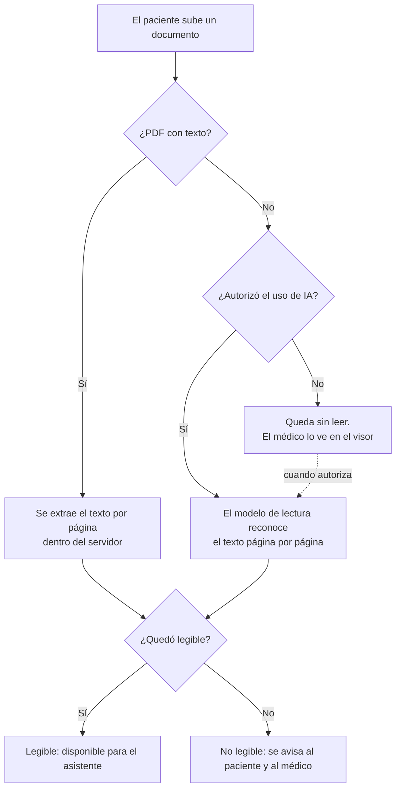
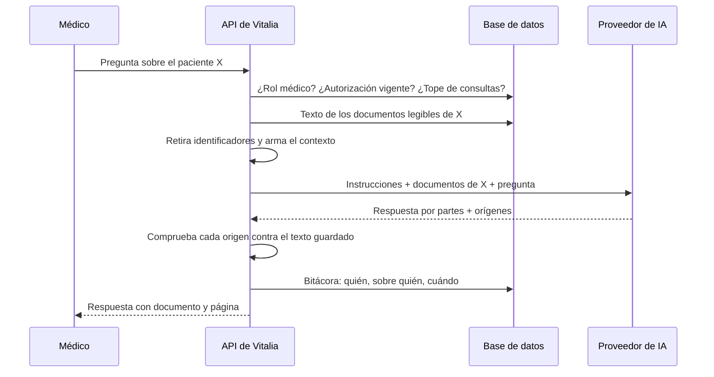

# Asistente de IA

**Fase del ciclo de vida:** Diseño
**Versión:** 1.0 · 12 de octubre de 2026

Cómo el médico le pregunta al asistente sobre los documentos de un paciente (HU-031 a HU-035) y con qué proveedor.

---

## 1. Proveedor

La idea del dueño del proyecto es arrancar con un modelo chino económico (DeepSeek o Qwen) para tener una primera versión rápido, y pasar después a una API empresarial.

| | DeepSeek (API directa) | Qwen (Alibaba Cloud, plataforma internacional) |
|---|---|---|
| Forma de conectarse | Compatible con el formato de OpenAI | Compatible con el formato de OpenAI |
| Texto que admite por consulta | Hasta 1 millón de unidades de texto | Hasta 1 millón en `qwen-plus`, según su documentación; hay fuentes que dan menos |
| Lectura de fotos y escaneados | Solo un modelo experimental que reduce cada imagen a muy poco detalle | Sí, con un modelo dedicado a reconocer texto (`qwen-vl-ocr`) |
| Precio aproximado por millón | 0,14 a 0,30 USD de entrada; 0,28 a 1,20 de salida | 0,40 USD de entrada; 1,20 de salida |
| Dónde quedan los datos | En servidores en China | Se puede elegir Singapur o Estados Unidos |
| Uso de los datos para entrenar | Sí por defecto, según análisis de terceros; sin exclusión clara para la API | Su aviso de privacidad dice que no, según fuentes de terceros; por confirmar |

**Decisión: Qwen para la primera versión.** Tres razones:

1. Un solo proveedor cubre las dos tareas: leer fotos y escaneados, y responder preguntas. Con DeepSeek haría falta otro servicio para la lectura.
2. Permite que los datos no queden en China continental.
3. Sus condiciones de uso de datos son más favorables, aunque falta confirmarlas en el contrato.

DeepSeek sale un poco más barato, pero la diferencia es de fracciones de centavo por pregunta y no compensa lo anterior.

> **Límite de la primera versión.** Con cualquiera de los dos, el sistema se prueba **solo con documentos inventados o anonimizados**. Para cargar documentos de pacientes reales hacen falta dos cosas: la respuesta del abogado a la pregunta 2 del [marco normativo](../planificacion/03-marco-normativo.md) y un contrato de tratamiento de datos con el proveedor. Enviar historias clínicas reales a DeepSeek directo no es defendible frente a la Ley 1581.

**Camino hacia la API empresarial.** Como los dos usan el formato de OpenAI, el cambio de proveedor es de configuración: dirección, clave y nombre del modelo. Una opción que conserva los mismos modelos es Amazon Bedrock, que ofrece DeepSeek y Qwen con el compromiso de no compartir los datos con el fabricante ni usarlos para entrenar.

## 2. El adaptador

Todo el sistema habla con una sola pieza interna, el adaptador de IA, que tiene dos funciones: **leer una página** (imagen a texto) y **responder** (texto a texto). El adaptador es el único lugar que conoce al proveedor.

| Variable de configuración | Qué define |
|---|---|
| `IA_DIRECCION` | Dirección del proveedor |
| `IA_CLAVE` | Clave de acceso. Vive solo en el servidor |
| `IA_MODELO_RESPUESTAS` | Modelo para preguntas y resúmenes |
| `IA_MODELO_LECTURA` | Modelo para reconocer texto en imágenes |
| `IA_TOPE_CONTEXTO` | Máximo de texto que se envía en una consulta |
| `IA_TOPE_CONSULTAS_HORA` | Máximo de consultas por hora |

## 3. Lectura de documentos (HU-031)

- **Legible** significa que la página trae una cantidad mínima de texto reconocible. El umbral se ajusta con la prueba de concepto 1 de la [arquitectura](01-arquitectura.md).
- Cuando el paciente autoriza la IA, los documentos que estaban sin leer entran a la cola.
- Cuando retira la autorización, no se lee nada más y el asistente se deshabilita; el texto ya leído se conserva hasta que elimine el documento.

## 4. Una pregunta, paso a paso (HU-033, HU-034)

### 4.1 Armado del contexto

- Entran **solo** los documentos legibles del paciente consultado. Cada uno va rotulado con una etiqueta corta (D1, D2…), su nombre y su fecha, y cada página con su número.
- Antes de enviar se reemplazan por rótulos el nombre del paciente, su número de documento, su celular y su correo. Es una protección parcial: dentro del texto pueden quedar otros datos que lo identifiquen.
- Si el texto supera `IA_TOPE_CONTEXTO`, se envían los resúmenes por documento más las páginas donde aparecen las palabras de la pregunta, y el médico ve el aviso de que la consulta fue parcial. En la primera versión no se usa una base de datos especial de búsqueda semántica; no hace falta para diez o veinte documentos por paciente.

### 4.2 Instrucciones fijas del asistente

> Eres un asistente que ayuda a un médico a consultar documentos clínicos que un paciente entregó.
> 1. Responde únicamente con lo que está escrito en los documentos.
> 2. Después de cada dato indica su origen así: [D2, pág. 1].
> 3. Si la información no aparece, responde "No aparece en los documentos". No supongas ni completes.
> 4. No des diagnósticos ni recomiendes tratamientos. Si te lo piden, aclara que solo resumes lo registrado.
> 5. Si dos documentos se contradicen, muestra ambos datos con su origen.
> 6. Responde en español, de forma breve y en orden de fecha.

### 4.3 Comprobación de los orígenes

El modelo puede equivocarse al citar. Por eso el servidor comprueba cada origen antes de mostrarlo:

| Comprobación | Si falla |
|---|---|
| El documento citado pertenece al paciente y la página existe | El origen se descarta |
| El fragmento citado aparece en el texto guardado de esa página | El dato se muestra marcado como "origen sin verificar" |

Cada origen verificado es un enlace que abre el visor en esa página (HU-034, CA-2).

### 4.4 Conversación

Las preguntas siguientes de la misma sesión envían también los turnos anteriores, para que el asistente mantenga el hilo. La conversación no se guarda en la base de datos: se pierde al cerrar la ficha.

## 5. Resumen del paciente (HU-035)

Es una pregunta fija con formato fijo. El resultado sí se guarda, con su fecha, para no generarlo en cada visita.

| Sección | Contenido |
|---|---|
| Diagnósticos | Con fecha y origen |
| Procedimientos | Cirugías, exámenes invasivos, hospitalizaciones |
| Tratamientos y medicamentos | Nombre, dosis y periodo, si aparecen |
| Alergias | O "no aparece en los documentos" |
| Estado más reciente | Lo último registrado, con su fecha |

Las secciones siguen los grupos de datos clínicos relevantes de la Resolución 866 de 2021. Cuando el paciente sube o elimina un documento, el resumen queda marcado como desactualizado.

## 6. Límites y costo

| Tema | Diseño |
|---|---|
| Tope de consultas | 30 por hora para el médico, configurable |
| Tiempo de espera | Si el proveedor no responde en 60 segundos, se avisa y no se reintenta solo |
| Proveedor caído | El asistente muestra el aviso; los documentos siguen disponibles en el visor |
| Costo por pregunta | Menos de un centavo de dólar con diez documentos de cuatro páginas (unas 20.000 unidades de texto de entrada) |
| Costo mensual estimado | 10 a 25 USD con cien preguntas por día hábil |

El costo es una estimación con precios publicados por terceros; se confirma con la factura del primer mes de pruebas.

## 7. Cómo se prueba

| Prueba | Qué demuestra | Historia |
|---|---|---|
| Veinte preguntas con respuesta conocida sobre diez documentos de ejemplo | Que responde bien y cita el origen correcto | HU-034 |
| Preguntas cuya respuesta no está | Que dice "no aparece" en vez de inventar | HU-034 |
| Preguntas de diagnóstico y de tratamiento | Que se abstiene | HU-034 |
| Dos pacientes con documentos distintos | Que nunca mezcla | HU-033 |
| Paciente sin autorización | Que no se llama al proveedor | HU-033 |
| Documentos con datos contradictorios | Que el resumen muestra ambos | HU-035 |

Estas pruebas se repiten cada vez que cambie el modelo o el proveedor.

## Fuentes

- [DeepSeek: lanzamiento del modelo experimental con imágenes](https://api-docs.deepseek.com/news/news260821/)
- [DeepSeek: precios 2026 (nxcode)](https://www.nxcode.io/resources/news/deepseek-api-pricing-complete-guide-2026)
- [DeepSeek: privacidad en 2026](https://deepseekai.guide/guides/deepseek-privacy/)
- [Alibaba Cloud Model Studio: precios](https://www.alibabacloud.com/help/en/model-studio/model-pricing)
- [Alibaba Cloud Model Studio: modelos de visión](https://www.alibabacloud.com/help/en/model-studio/vision-model/)
- [Amazon Bedrock: protección de datos](https://docs.aws.amazon.com/bedrock/latest/userguide/data-protection.html)
- [Amazon Bedrock: modelos Qwen](https://aws.amazon.com/bedrock/qwen)
