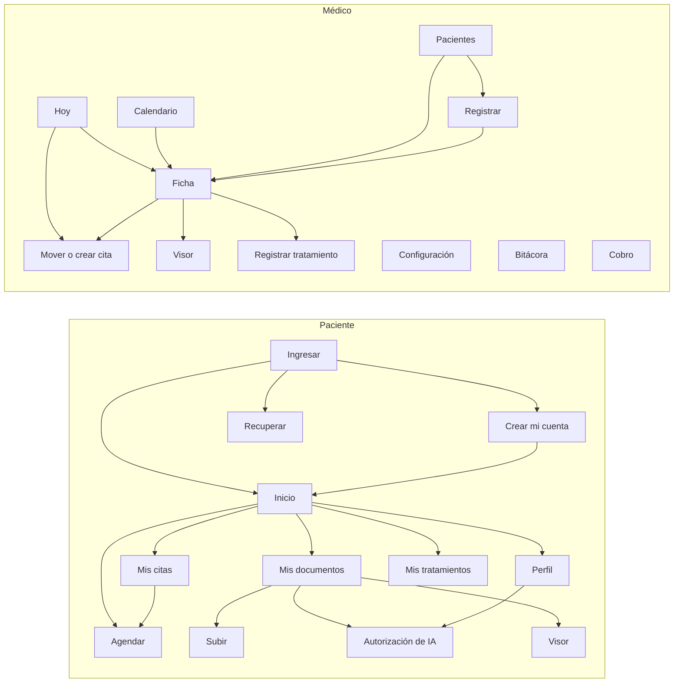

# Pantallas

**Fase del ciclo de vida:** Diseño
**Versión:** 1.0 · 12 de octubre de 2026

Inventario de pantallas, cómo se pasa de una a otra y qué historia cubre cada una. Todas están en el prototipo navegable.

---

## 1. Prototipo navegable

| | |
|---|---|
| **Enlace** | https://claude.ai/artifact/4MN2vq99tcrQBzUWDJ4pEy |
| **Archivo** | [prototipo/index.html](prototipo/index.html) |
| **Acceso** | Privado. Para mostrárselo a otra persona hay que compartirlo desde el menú "Share" de la página |

Cómo usarlo:

- Arriba a la derecha se cambia entre **Paciente** y **Médico**. Ese control existe solo en el prototipo, para recorrer los dos lados sin iniciar sesión dos veces; en el producto cada persona entra con su cuenta y ve únicamente su parte. Los dos comparten los mismos datos: lo que hace uno se refleja en el otro.
- Al pie de cada pantalla aparecen las historias de usuario que cubre.
- Todo es de ejemplo. Nada se guarda ni se envía; al recargar la página vuelve al estado inicial.
- La fecha del prototipo es el martes 13 de octubre de 2026, a las 7:40 a. m.

**Recorridos para probar**

| # | Recorrido | Qué demuestra |
|---|---|---|
| 1 | Como paciente: Citas → Mover la cita de hoy | La regla de 24 horas: no deja y muestra el teléfono |
| 2 | Como paciente: Agendar → elegir tipo y día | Solo aparecen los días y las horas disponibles; lo ocupado y lo bloqueado no se muestra |
| 3 | Como médico: Configuración → Bloqueos → bloquear un rato con citas | No deja bloquear hasta mover o cancelar las citas afectadas |
| 4 | Como médico: Hoy → Cancelar una cita sin motivo | El motivo es obligatorio para el médico |
| 5 | Como médico: Pacientes → Rosa Elena → Generar resumen y preguntar | Respuestas con documento y página; al tocar el origen se abre el visor con el fragmento resaltado |
| 6 | Como médico: preguntar "¿Qué tratamiento le recomiendas?" | El asistente se abstiene |
| 7 | Como paciente: Perfil → retirar la autorización de IA; luego volver como médico a la ficha | El asistente queda deshabilitado de inmediato |
| 8 | Como paciente: Mi perfil → Cerrar sesión → Crear mi cuenta | Contraseña con reglas y, al final, la ventana de tratamiento de datos con el uso de IA resaltado |
| 9 | Como médico: Calendario → Mes → Mes anterior → tocar el 14 de septiembre | Navegación entre meses y apertura del día con sus citas |
| 10 | Como médico: ficha de Rosa Elena → Registrar tratamiento; luego como paciente: Tratamientos | El tratamiento que guarda el médico aparece de inmediato como "Último tratamiento" del paciente |

## 1.1 Diseño visual pulido

| | |
|---|---|
| **Enlace** | https://claude.ai/artifact/R6WLHr5eAt7FQztseugqQY |
| **Qué es** | Lienzo de diseño con diez pantallas en su versión visual pulida: siete del paciente (celular) y tres del médico (computador) |
| **Acceso** | Privado; se comparte desde el menú "Share" de la página |

Pantallas incluidas: ingresar, tratamiento de datos al registrarse, inicio, agendar, mis citas, mis tratamientos y mis documentos del paciente; agenda de hoy, calendario del mes y ficha del paciente del médico.

El lienzo define el aspecto: iconos, tarjetas, etiquetas de estado, barra inferior del paciente y menú lateral del médico. El prototipo navegable de arriba sigue siendo la referencia del comportamiento y conserva el aspecto anterior hasta que se apruebe este.

## 2. Pantallas del paciente

Pensadas primero para celular.

| Código | Pantalla | Qué hace | Historias |
|---|---|---|---|
| P-01 | Ingresar | Correo y contraseña; enlaces a crear cuenta y recuperar | HU-004 |
| P-02 | Crear mi cuenta | Datos, contraseña y, al final, una ventana con los puntos clave de la política de datos: el uso de IA va resaltado y tiene su propia casilla | HU-002, HU-003, HU-032 |
| P-03 | Recuperar la contraseña | Pide el correo y confirma el envío del enlace | HU-005 |
| P-04 | Inicio | Próxima cita con mover y cancelar; accesos; tratamiento vigente; invitación a subir documentos | HU-020 |
| P-05 | Agendar una cita | Tres pasos: tipo, día y hora, confirmación. Solo lista días y horas disponibles | HU-012, HU-011 |
| P-06 | Mis citas | Próximas y anteriores con su estado; mover y cancelar | HU-013, HU-014, HU-015 |
| P-07 | Mis documentos | Lista con estado de lectura; ver y eliminar; estado de la autorización de IA | HU-029, HU-031 |
| P-08 | Subir un documento | Archivo, nombre, fecha, tipo y formato | HU-028 |
| P-09 | Autorización de IA | Explica qué hace el asistente; autorizar, rechazar o retirar | HU-032 |
| P-10 | Mi perfil | Datos, autorizaciones y cierre de sesión | HU-003, HU-032, HU-007 |
| P-11 | Visor | Documento por páginas, con tamaño de texto ajustable | HU-029, HU-027 |
| P-12 | Mis tratamientos | Último tratamiento con cada medicamento y cómo tomarlo; tratamientos anteriores con su detalle | HU-039 |

El paciente tiene cuatro pestañas: Inicio, Citas, Tratamientos y Documentos. "Mi perfil" queda como enlace en la parte de arriba.

## 3. Pantallas del médico

Pensadas primero para computador; en celular el menú pasa arriba.

| Código | Pantalla | Qué hace | Historias |
|---|---|---|---|
| M-01 | Hoy | Agenda del día; marcar asistencia, mover y cancelar; aviso de lo que falta por configurar | HU-021, HU-018, HU-017 |
| M-02 | Calendario | Vistas de día, semana y mes, cada una con anterior y siguiente; en el mes, tocar un día abre sus citas; crear cita o bloqueo sobre un espacio libre | HU-022, HU-016, HU-009 |
| M-03 | Mover o crear cita | Elegir día y espacio para un paciente | HU-016, HU-017, HU-011 |
| M-04 | Pacientes | Lista y búsqueda por nombre o documento | HU-023 |
| M-05 | Registrar un paciente | Datos básicos; envía el enlace de activación | HU-024 |
| M-06 | Ficha del paciente | Datos, citas, documentos, tratamientos y asistente | HU-025, HU-033, HU-034, HU-035 |
| M-14 | Registrar tratamiento | Motivo, hasta dos medicamentos con dosis, frecuencia, duración y cómo tomarlos, e indicaciones | HU-038 |
| M-07 | Visor | Documento por páginas, sin descarga, con el fragmento citado resaltado | HU-030, HU-027 |
| M-08 | Configuración: horario | Franjas de mañana y tarde por día | HU-008 |
| M-09 | Configuración: bloqueos | Lista y nuevo bloqueo, con aviso de citas afectadas | HU-009 |
| M-10 | Configuración: tipos de cita | Lista, activar o desactivar, nuevo tipo | HU-010 |
| M-11 | Configuración: consultorio | Datos del consultorio y horas mínimas para mover o cancelar | HU-001 |
| M-12 | Bitácora | Registros filtrados por paciente | HU-037 |
| M-13 | Cobro | Aviso de función no disponible | HU-026 |

La creación de la cuenta del médico con el enlace de puesta en marcha (HU-001) ocurre una sola vez y no está en el prototipo. Tampoco tienen pantalla propia las historias de rol "Sistema" sin interfaz: HU-006, HU-036 y el envío de correos de HU-019.

## 4. Navegación

## 5. Criterios de diseño aplicados

| Criterio | Cómo se ve en el prototipo |
|---|---|
| Legible para adultos mayores | Letra diseñada para baja visión, texto de 16 puntos como mínimo, botones de 44 puntos de alto |
| Estado visible sin leer | Cada cita y cada documento llevan una etiqueta de color con su estado |
| Confirmar antes de borrar | Cancelar una cita o eliminar un documento pide confirmación en la misma pantalla |
| Errores que dicen qué hacer | "Faltan menos de 24 horas… llame al consultorio", con el teléfono |
| Claro y oscuro | Las dos apariencias, según la configuración del equipo |
| Trazabilidad | El pie de cada pantalla lista las historias que cubre |

## 6. Diferencias entre el prototipo y el producto

- La vista de semana del calendario se desplaza hacia los lados en celular; en el producto, en celular se abre directamente la vista de día (HU-022, CA-4).
- En el producto no existe el control "ver como": cada persona entra con su cuenta.
- El formulario de tratamiento del prototipo admite dos medicamentos; en el producto se pueden agregar los que hagan falta.
- La lectura de documentos y las respuestas del asistente son simuladas con cuatro documentos de ejemplo.
- La carga de archivos no sube nada.
- No hay bloqueo real por intentos fallidos ni vencimiento de sesión.
