# Diagramas de arquitectura

**Fase del ciclo de vida:** Diseño
**Versión:** 1.2 · 13 de octubre de 2026

Todos los diagramas están en código Mermaid: se ven dibujados en GitHub, en VS Code con la extensión de Mermaid o pegándolos en https://mermaid.live. Van de lo general a lo particular. La explicación de cada decisión está en [01-arquitectura.md](01-arquitectura.md).

---

## 1. Contexto: quién usa el sistema y con qué se conecta

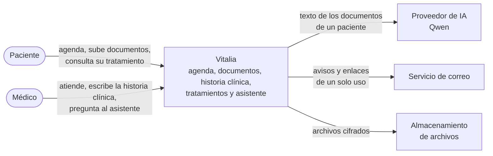

## 2. Contenedores: las piezas que se despliegan

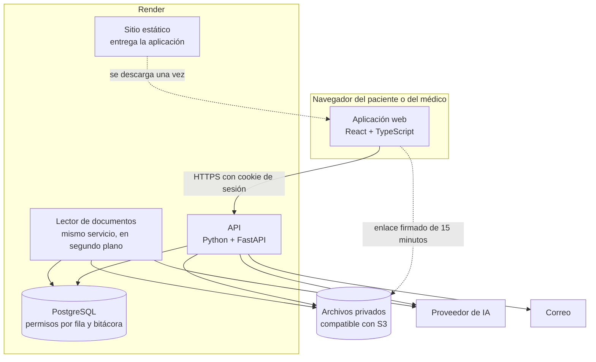

La aplicación web nunca llama al proveedor de IA ni al correo. A los archivos solo llega con el enlace temporal que la API le entrega.

## 3. Componentes de la API

La API se organiza con arquitectura limpia: las flechas continuas son dependencias y todas apuntan hacia el dominio.

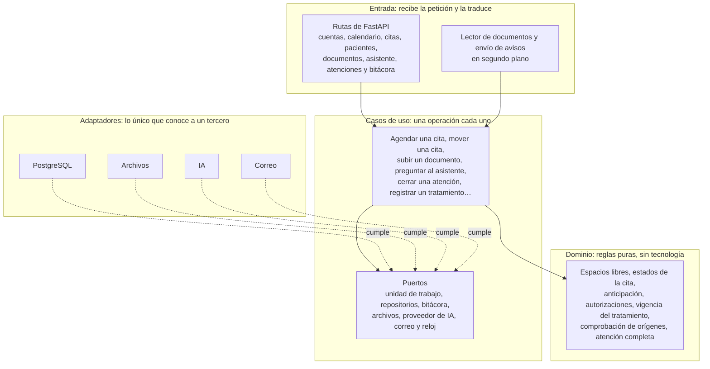

En cada petición, en este orden: la entrada encuentra la sesión; el caso de uso verifica el permiso del rol; la unidad de trabajo abre la transacción y le indica el usuario a la base; el dominio aplica la regla; se guarda y se escribe la bitácora en la misma transacción.

Cambiar de proveedor de IA, de almacenamiento o de correo toca un solo adaptador. El detalle de las capas está en la sección 7 de [01-arquitectura.md](01-arquitectura.md).

## 4. Despliegue

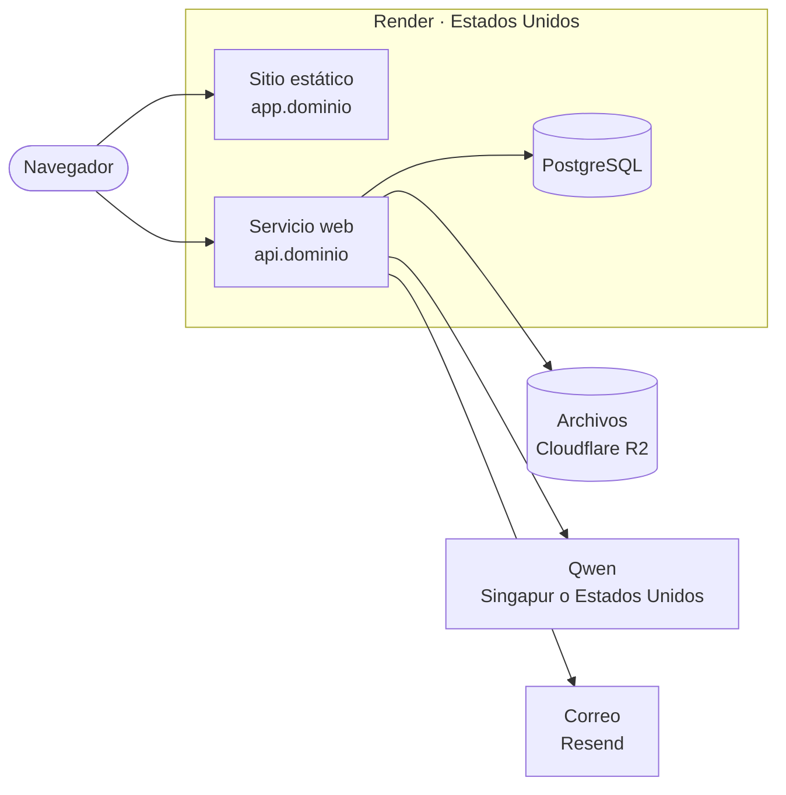

| Variable de entorno del servicio web | Para qué |
|---|---|
| `BD_URL` | Conexión a PostgreSQL con el usuario sin privilegios de dueño |
| `ARCHIVOS_*` | Dirección, espacio y claves del almacenamiento |
| `IA_DIRECCION`, `IA_CLAVE`, `IA_MODELO_RESPUESTAS`, `IA_MODELO_LECTURA` | Proveedor de IA |
| `CORREO_CLAVE` | Servicio de correo |
| `SESION_SECRETO` | Firma de enlaces de un solo uso |

Ninguna de estas variables llega al navegador.

## 5. Secuencias

### 5.1 Ingreso y petición con sesión

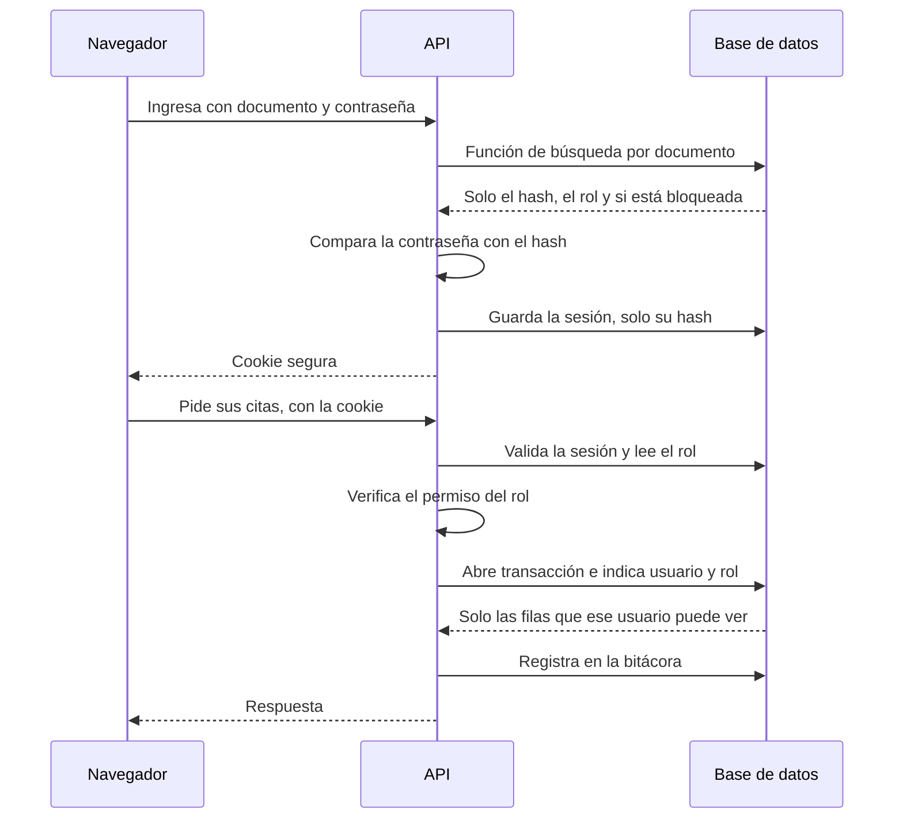

### 5.2 Dos pacientes confirman el mismo espacio

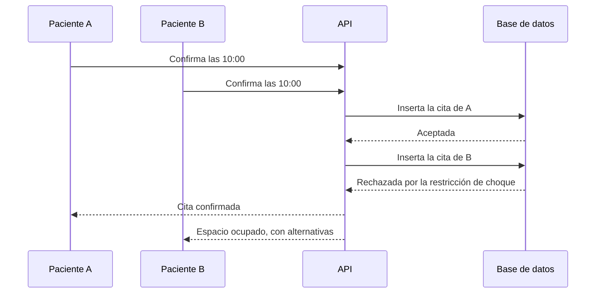

La base de datos es la que impide el choque, no solo el código.

### 5.3 Subida y lectura de un documento

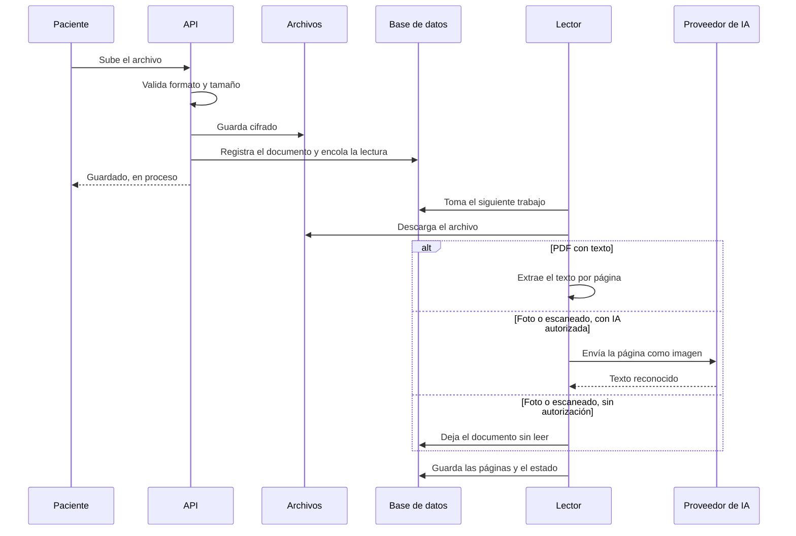

### 5.4 Pregunta al asistente

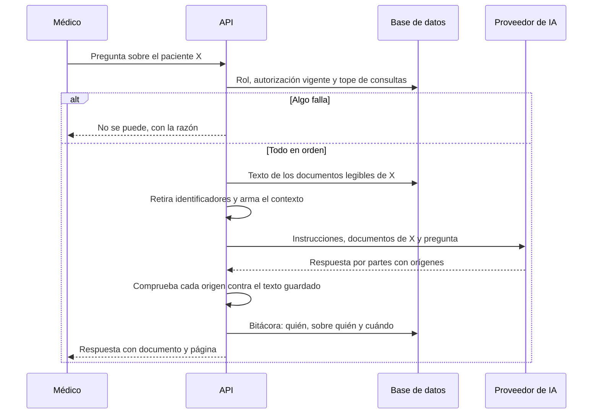

### 5.5 El médico registra un tratamiento

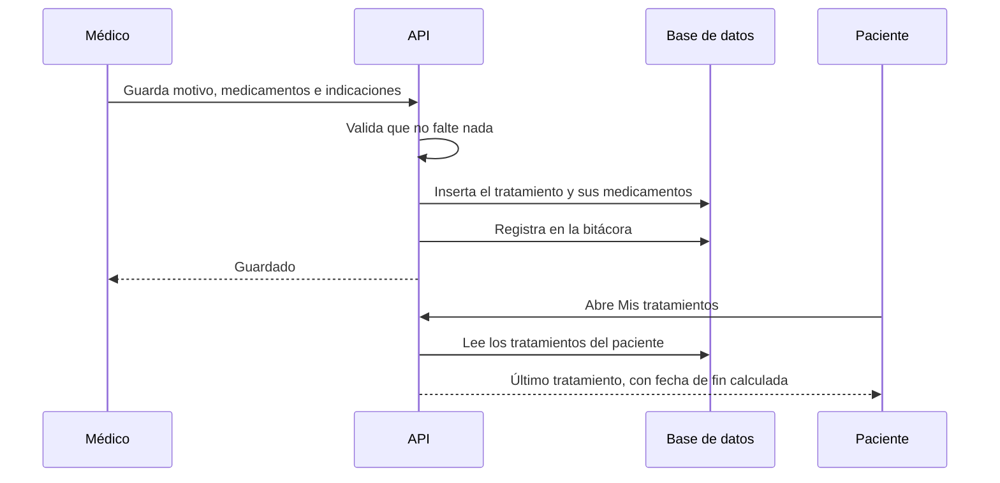

### 5.6 Atención y cierre de la historia clínica

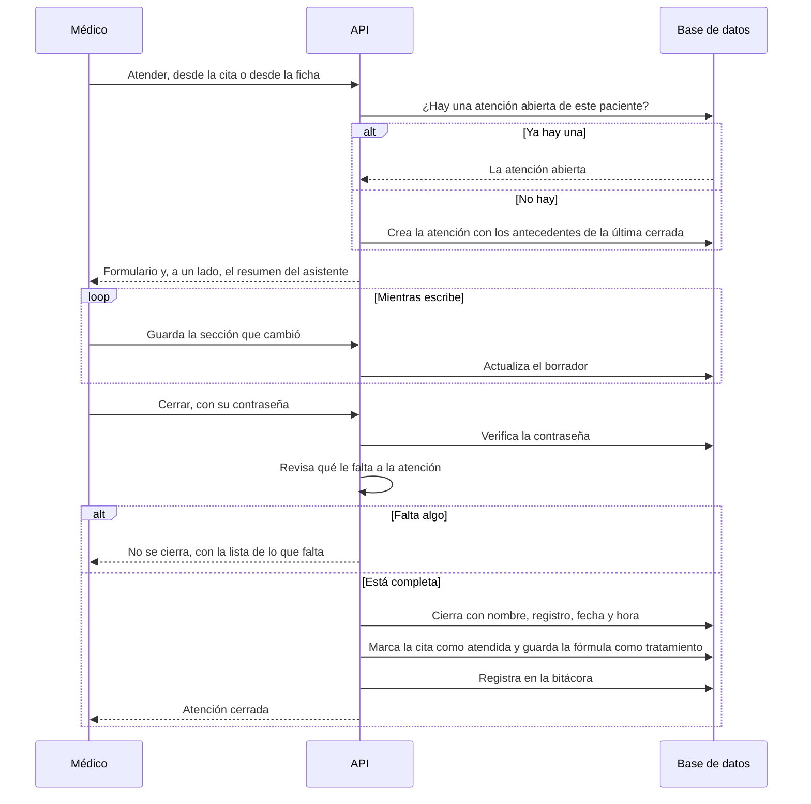

Desde ese momento la base rechaza cualquier cambio. Una corrección es una nota aclaratoria que se suma.

## 6. Estados

### 6.1 Cita

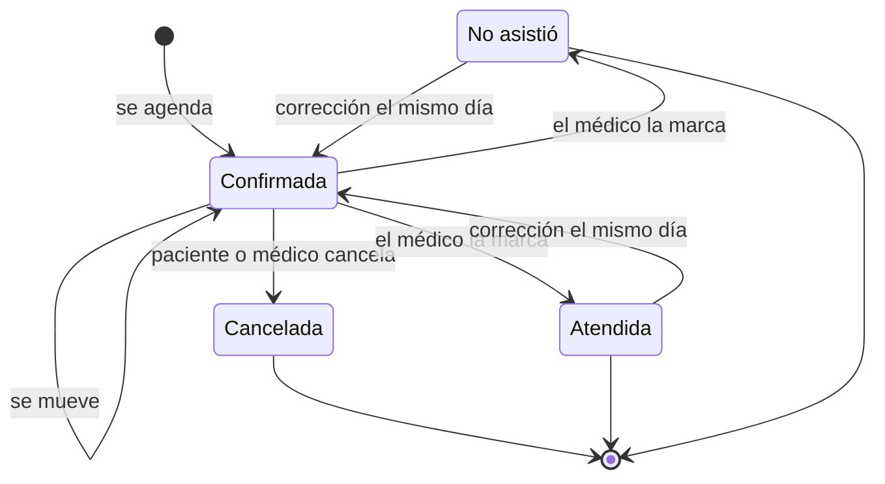

### 6.2 Lectura de un documento

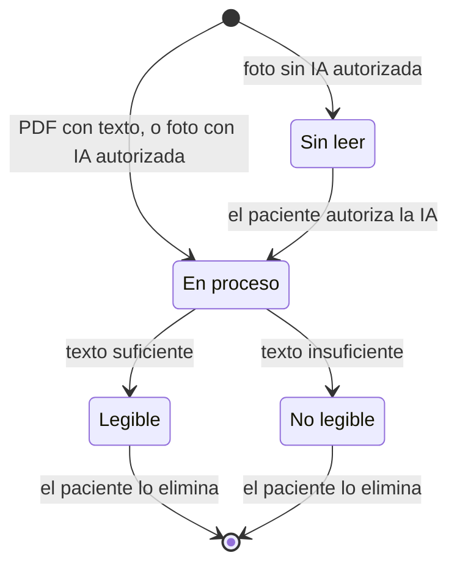

### 6.3 Autorización de IA del paciente

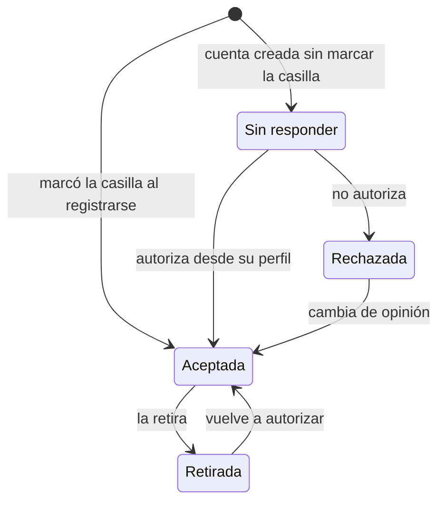

El asistente solo funciona en el estado **Aceptada**.

### 6.4 Atención de la historia clínica

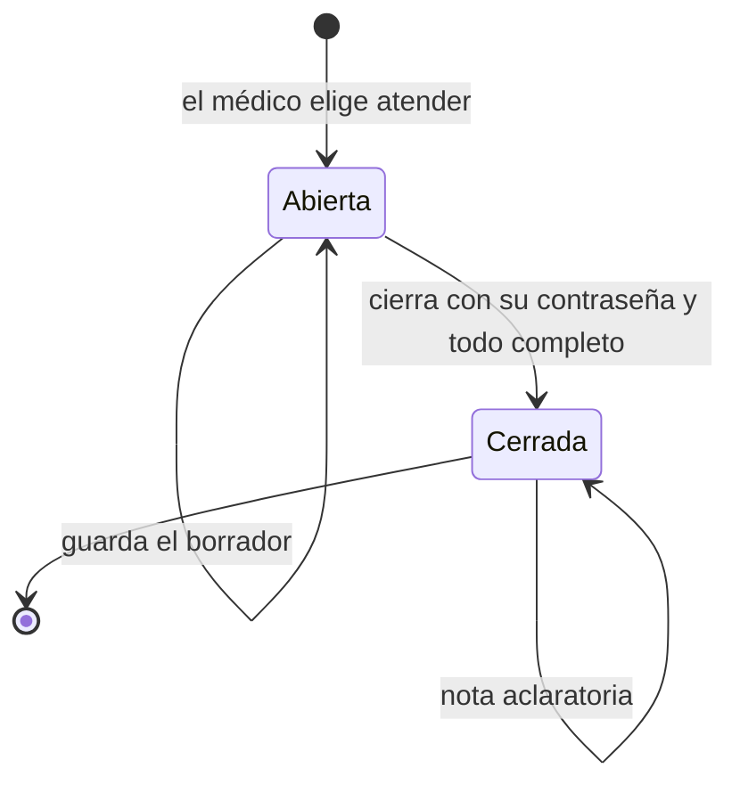

Una atención cerrada no vuelve a abrirse ni se borra. Un paciente tiene como mucho una atención abierta.

## 7. Datos

El diagrama de tablas y sus relaciones está en [02-modelo-de-datos.md](02-modelo-de-datos.md).
