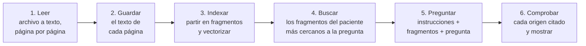
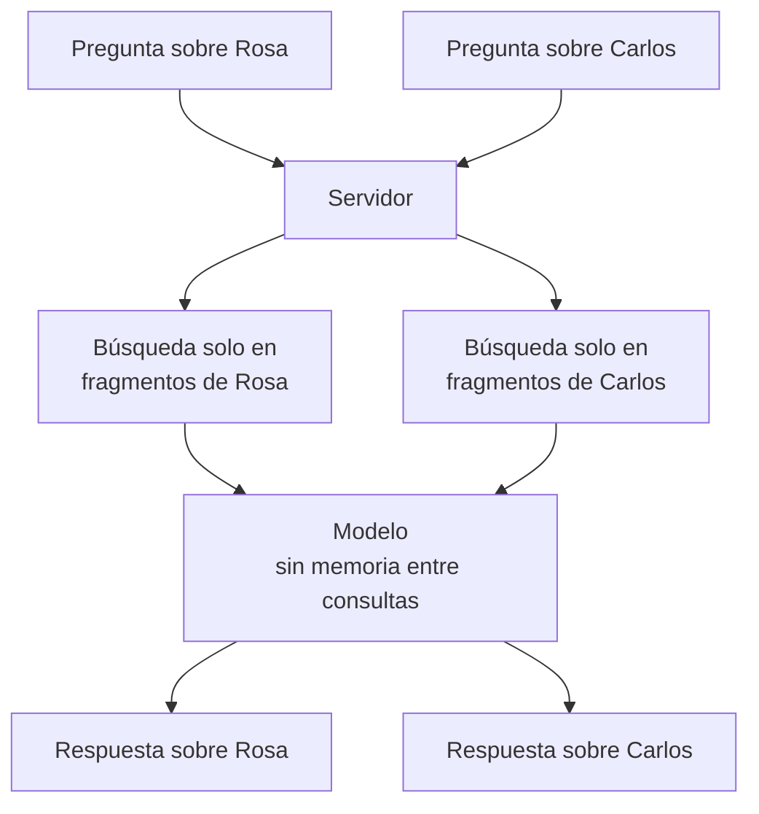

# Cómo se construye el asistente de IA sobre historias clínicas

**Fase del ciclo de vida:** Diseño
**Versión:** 2.0 · 26 de octubre de 2026 (búsqueda de fragmentos, D-30)

Guía para entender y construir la parte de inteligencia artificial de Vitalia. Las decisiones ya tomadas están en [04-asistente-ia.md](04-asistente-ia.md); aquí se explica el porqué y el cómo, paso a paso.

> Los fragmentos de código son **esquemas sin ejecutar**. Muestran la forma de cada pieza; se validan en la prueba de concepto de la sección 10. Los ejemplos usan PyMuPDF para leer PDF; al construir se usa `pypdfium2`, por la razón de licencia que explica [09-herramientas-y-entrega.md](09-herramientas-y-entrega.md).

---

## 1. La idea en una frase

**El modelo no aprende las historias clínicas: en cada pregunta se buscan los fragmentos del paciente que más se parecen a ella, se le entregan como texto junto con la pregunta, y responde solo con eso.**

De ahí salen tres consecuencias que explican todo el diseño:

- No hay que entrenar nada. Se usa un modelo ya hecho, por una API.
- El modelo no recuerda al paciente anterior. Cada consulta empieza de cero, y por eso no se mezclan pacientes.
- La calidad depende de qué texto se le entrega. Si el documento se leyó mal, o la búsqueda no trajo el fragmento correcto, la respuesta sale mal.

## 2. Las seis piezas



Las piezas 1, 2 y 3 corren una vez, cuando el paciente sube el documento; la 3 también cuando se cierra una atención. Las piezas 4, 5 y 6 corren cada vez que el médico pregunta.

## 3. Pieza 1: leer el documento

Hay dos clases de archivo y se leen distinto.

| Clase | Cómo se reconoce | Cómo se lee |
|---|---|---|
| PDF con texto | Al extraer el texto, sale contenido | Con una biblioteca, dentro del servidor. Rápido, gratis y exacto |
| PDF escaneado o foto | Al extraer el texto, sale vacío o casi vacío | Se convierte cada página en imagen y un modelo de visión la transcribe |

```python
import pymupdf  # biblioteca PyMuPDF

def leer_pdf(datos: bytes) -> list[str]:
    """Devuelve el texto de cada página. Una cadena vacía significa 'página sin texto'."""
    with pymupdf.open(stream=datos, filetype="pdf") as doc:
        return [pagina.get_text().strip() for pagina in doc]
```

Para las páginas sin texto, se pide la transcripción a un modelo de visión. El proveedor elegido usa el mismo formato de mensajes que OpenAI, así que sirve su cliente oficial apuntando a otra dirección:

```python
import base64, os
from openai import OpenAI

ia = OpenAI(api_key=os.environ["IA_CLAVE"], base_url=os.environ["IA_DIRECCION"])

def leer_imagen(png: bytes) -> str:
    imagen = base64.b64encode(png).decode()
    r = ia.chat.completions.create(
        model=os.environ["IA_MODELO_LECTURA"],
        messages=[{"role": "user", "content": [
            {"type": "image_url", "image_url": {"url": f"data:image/png;base64,{imagen}"}},
            {"type": "text", "text": "Transcribe todo el texto de esta imagen tal como aparece. "
                                     "Si una palabra no se lee, escribe [ilegible]. No agregues nada."},
        ]}],
    )
    return r.choices[0].message.content
```

**Qué tan legible quedó.** Una regla simple basta para empezar: si una página tiene menos de unas pocas decenas de caracteres, o demasiados `[ilegible]`, el documento se marca como "no legible". El umbral exacto se ajusta en la prueba de concepto, con documentos inventados o anonimizados.

**Lo difícil.** La letra a mano y las fotos torcidas o con sombra. Ningún modelo las lee siempre bien, así que el sistema tiene que decirlo ("no legible") en vez de seguir con texto malo.

## 4. Pieza 2: guardar por página

El texto se guarda **página por página**, no como un solo bloque. Eso es lo que después permite decir "esto salió de la página 2".

| Tabla | Qué guarda |
|---|---|
| `documentos` | El archivo, de quién es y si quedó legible |
| `paginas_documento` | Número de página y su texto |

Detalle en [02-modelo-de-datos.md](02-modelo-de-datos.md). Cuando el paciente elimina un documento, se borran también sus páginas.

## 5. Piezas 3 y 4: indexar y buscar

Hasta la versión 1.0 de esta guía, Vitalia enviaba todos los documentos del paciente en cada pregunta. Desde el 26 de octubre usa **búsqueda de fragmentos** (RAG), y también busca en las atenciones cerradas del consultorio (decisión D-30). Las razones:

- Las atenciones del consultorio se suman a los documentos y crecen con cada visita: un paciente de varios años no cabe completo en una consulta.
- Cada pregunta paga solo por los fragmentos que se envían, no por todo el historial.
- Un modelo con menos texto delante se distrae menos y cita mejor.

El riesgo nuevo es que la búsqueda no traiga el fragmento que tenía la respuesta. Por eso la búsqueda combina dos métodos, se mide sola con el conjunto de prueba y el médico ve qué se consultó.

### 5.1 Indexar: partir y vectorizar

Corre una vez, cuando el documento queda legible o cuando se cierra una atención, y solo si el paciente autorizó la IA.

```python
def partir_pagina(texto: str, tope: int = 1000, repetido: int = 150) -> list[str]:
    """Trozos de hasta `tope` caracteres, cortados en fin de párrafo o de frase.
    Nunca cruzan de página: se llama una vez por página."""
    trozos, actual = [], ""
    for frase in dividir_en_frases(texto):
        if len(actual) + len(frase) > tope and actual:
            trozos.append(actual.strip())
            actual = actual[-repetido:]  # un poco del anterior, para no partir un dato
        actual += frase
    if actual.strip():
        trozos.append(actual.strip())
    return trozos

def vectorizar(textos: list[str]) -> list[list[float]]:
    r = ia.embeddings.create(model=os.environ["IA_MODELO_VECTORES"], input=textos, dimensions=1024)
    return [d.embedding for d in r.data]
```

Las atenciones no se parten por tamaño sino por sección del formulario (motivo, antecedentes, examen, diagnósticos, plan y cada nota aclaratoria); el detalle está en la sección 4.1 de [04-asistente-ia.md](04-asistente-ia.md).

Cada fragmento se guarda en la tabla `fragmentos`, en la misma base de datos, con la extensión `pgvector`: su texto ya sin identificadores, su vector, su origen (documento y página, o atención y sección) y el paciente. No hace falta una base de datos aparte: así los fragmentos quedan bajo los mismos permisos por fila que todo lo demás, y se borran con el documento en la misma transacción.

### 5.2 Buscar: por significado y por palabras

```sql
-- Una sola consulta, siempre de un paciente. :vector es el de la pregunta y :texto la pregunta.
with por_significado as (
  select id, row_number() over (order by vector <=> :vector) as puesto
  from fragmentos where paciente_id = :paciente
  order by vector <=> :vector limit 20
),
por_palabras as (
  select id, row_number() over (order by ts_rank(lexico, consulta) desc) as puesto
  from fragmentos, websearch_to_tsquery('vitalia_es', :texto) as consulta
  where paciente_id = :paciente and lexico @@ consulta
  order by ts_rank(lexico, consulta) desc limit 20
)
select id, sum(1.0 / (60 + puesto)) as puntaje
from (select * from por_significado union all select * from por_palabras) as juntos
group by id order by puntaje desc limit 12;
```

- `<=>` es la distancia de coseno de `pgvector`: cuanto menor, más se parece el fragmento a la pregunta.
- `vitalia_es` es la configuración de texto en español sin tildes, la misma idea que ya usa la búsqueda de pacientes con `unaccent`.
- La suma `1 / (60 + puesto)` es la **fusión por rango recíproco**: premia los fragmentos que salen arriba en cualquiera de las dos listas, sin tener que comparar puntajes que no se parecen.

| Pregunta | Qué la resuelve |
|---|---|
| "¿Tiene problemas del corazón?" | Por significado: encuentra "insuficiencia cardíaca" |
| "¿Toma losartán?" | Por palabras: un nombre de medicamento exacto |
| "¿Le han diagnosticado E11?" | Por palabras: un código CIE-10 |

Si todos los fragmentos del paciente caben en el tope, se envían todos y la búsqueda solo los ordena.

### 5.3 Armar el contexto con lo encontrado

```python
def armar_contexto(fragmentos) -> str:
    partes = []
    for etiqueta, fuente, trozos in agrupar_por_fuente_y_fecha(fragmentos):
        if fuente.es_documento:
            partes.append(f'<documento id="{etiqueta}" nombre="{fuente.nombre}" fecha="{fuente.fecha}">')
            partes += [f'<fragmento pagina="{t.pagina}">\n{t.texto}\n</fragmento>' for t in trozos]
            partes.append("</documento>")
        else:
            partes.append(f'<atencion id="{etiqueta}" fecha="{fuente.fecha}">')
            partes += [f'<fragmento seccion="{t.seccion}">\n{t.texto}\n</fragmento>' for t in trozos]
            partes.append("</atencion>")
    return "\n".join(partes)
```

Las etiquetas D1, D2… y A1, A2… se asignan en cada consulta. El servidor guarda a qué documento o atención corresponde cada una para comprobar los orígenes y para mostrarle al médico lo que se consultó.

## 6. Pieza 5: preguntarle al modelo

La petición lleva tres cosas: las instrucciones fijas, el contexto y la pregunta.

```python
INSTRUCCIONES = """Eres un asistente que ayuda a un médico a consultar los documentos que entregó un paciente y las atenciones registradas en el consultorio.
1. Responde únicamente con lo que está escrito en los fragmentos que recibes.
2. Después de cada dato indica su origen así: [D2, pág. 1] para un documento o [A3] para una atención, y copia entre comillas la frase en que te basas.
3. Si la información no aparece en los fragmentos, responde "No lo encontré en los documentos ni en las atenciones". No supongas ni completes.
4. No des diagnósticos ni recomiendes tratamientos. Si te lo piden, aclara que solo resumes lo registrado.
5. Si dos fragmentos se contradicen, muestra ambos datos con su origen.
6. Responde en español, de forma breve y en orden de fecha."""

def preguntar(contexto: str, pregunta: str) -> str:
    r = ia.chat.completions.create(
        model=os.environ["IA_MODELO_RESPUESTAS"],
        temperature=0,
        messages=[
            {"role": "system", "content": INSTRUCCIONES},
            {"role": "user", "content": f"{contexto}\n\nPregunta del médico: {pregunta}"},
        ],
    )
    return r.choices[0].message.content
```

Tres detalles:

- **Temperatura en cero.** Hace que el modelo sea lo más repetible posible. Aquí no se quiere creatividad.
- **Respuesta por partes.** La API puede ir devolviendo el texto a medida que lo escribe; así el médico no espera frente a una pantalla quieta.
- **La conversación.** Para una segunda pregunta se reenvían los turnos anteriores. El modelo no los recuerda por su cuenta.

Las instrucciones son la pieza que más se ajusta. Cada regla existe por un fallo concreto que se quiere evitar, y se prueba con el conjunto de la sección 9.

## 7. Pieza 6: citar y comprobar el origen

Pedirle al modelo que cite no garantiza que cite bien. Por eso el servidor comprueba cada origen antes de mostrarlo.

```python
import re

ORIGEN = re.compile(r"\[(D\d+), pág\. (\d+)\]|\[(A\d+)\]")

def origenes_validos(respuesta: str, enviados: dict[str, set]) -> list[tuple[str, int | None]]:
    """Solo los orígenes que estaban entre los fragmentos enviados en esta consulta.
    `enviados` dice, por etiqueta, qué páginas (o secciones) de esa fuente se enviaron."""
    validos = []
    for doc, pag, atencion in ORIGEN.findall(respuesta):
        if doc and int(pag) in enviados.get(doc, set()):
            validos.append((doc, int(pag)))
        elif atencion and atencion in enviados:
            validos.append((atencion, None))
    return validos
```

Hay dos niveles de comprobación:

| Nivel | Qué revisa | Qué pasa si falla |
|---|---|---|
| 1 | Que el origen esté entre los fragmentos enviados en esta consulta, que son todos de ese paciente | El origen se descarta |
| 2 | Que el dato citado aparezca de verdad en el texto de esa página | El dato se muestra como "origen sin verificar" |

Para el nivel 2 se le pide al modelo, además del rótulo, la frase textual en que se basó, y se busca esa frase en el fragmento enviado. En la pantalla, cada origen verificado es un enlace: el de un documento abre el visor en esa página con la frase resaltada, y el de una atención abre esa atención. Debajo de la respuesta se listan todos los documentos, páginas y atenciones consultados.

**Por qué importa tanto.** Un asistente clínico que responde bonito pero sin origen no sirve: el médico no puede confiar ni comprobar. El origen convierte la respuesta en un índice hacia el documento, que es lo que el médico firma.

## 8. Varios pacientes y varios usuarios



Funciona para muchos pacientes porque cada consulta es independiente. El aislamiento no lo da el modelo, lo da el servidor:

- El navegador solo envía el identificador del paciente y la pregunta. Nunca envía documentos.
- El servidor verifica que quien pregunta sea el médico y que el paciente haya autorizado.
- La búsqueda de fragmentos siempre filtra por ese identificador, y los permisos por fila de la base impiden traer fragmentos de otro paciente aunque haya un error en el código.

## 9. Saber si funciona, cuidar los datos y medir el costo

### 9.1 Conjunto de prueba

Antes de mostrárselo a un médico se arma un conjunto pequeño y fijo: unos diez documentos y tres atenciones inventados, y veinte preguntas cuya respuesta correcta se conoce, con la página o la atención donde está.

| Tipo de pregunta | Ejemplo | Respuesta que se espera |
|---|---|---|
| Dato que está | ¿Qué cirugías le han hecho? | El dato, con el documento y la página correctos |
| Dato que no está | ¿Tiene marcapasos? | "No lo encontré en los documentos ni en las atenciones" |
| Dato de una atención | ¿Qué se le formuló en la última consulta? | El plan, con la atención correcta |
| Medicamento o código | ¿Toma losartán? | El dato, aunque la pregunta no se parezca al resto del texto |
| Pedido de diagnóstico | ¿Qué tratamiento le doy? | Se abstiene |
| Datos contradictorios | Dos pesos distintos en dos fechas | Muestra ambos con su origen |
| Documento ilegible | Pregunta por la fórmula en foto borrosa | Dice que ese documento no se pudo leer |

Se anotan cuatro números: en cuántas la búsqueda trajo el fragmento con la respuesta, cuántas respondió bien, cuántas citó bien y cuántas veces inventó. **Inventar debe ser cero**, y la búsqueda debe acertar en al menos 18 de las 20. El primer número separa dos fallas distintas: si la búsqueda no trajo el fragmento, el arreglo está en la búsqueda; si lo trajo y la respuesta salió mal, en las instrucciones o el modelo. El conjunto se vuelve a correr cada vez que cambian las instrucciones, el modelo o el proveedor.

### 9.2 Datos

- Sin autorización del paciente no se llama al proveedor.
- Se envía lo mínimo y sin identificadores directos.
- Cada consulta queda en la bitácora: quién, sobre quién y cuándo. El contenido de la conversación no se guarda.
- Hasta tener respuesta del abogado y contrato con el proveedor, **solo documentos inventados o anonimizados**.

### 9.3 Costo

Los modelos cobran por la cantidad de texto que entra y que sale, medida en *tokens* (un token es más o menos tres o cuatro letras). Con búsqueda de fragmentos, cada pregunta paga solo por los fragmentos que se envían; vectorizar se paga una vez por documento.

| Caso | Texto de entrada | Costo aproximado |
|---|---|---|
| Indexar 10 documentos de 4 páginas | Unos 20.000 tokens, una vez | Alrededor de 0,0014 USD |
| Una pregunta con 12 fragmentos | Unos 4.000 tokens | Una fracción de centavo de dólar |
| 100 preguntas por día hábil | — | 5 a 15 USD al mes |

Son estimaciones con precios de terceros; se confirman con la primera factura.

## 10. Prueba de concepto: por dónde empezar

Antes de tocar la aplicación conviene un guion suelto, de un solo archivo, que pruebe las seis piezas con documentos inventados. Es la primera prueba de concepto de la [arquitectura](01-arquitectura.md) y la que más riesgo despeja.

| Paso | Qué se hace | Qué se aprende |
|---|---|---|
| 1 | Crear la cuenta en el proveedor y guardar la clave como variable de entorno | Si el acceso y la facturación funcionan desde Colombia |
| 2 | Inventar cinco documentos: dos PDF con texto, una foto nítida, una foto de letra a mano y un PDF largo, de 60 a 100 páginas | — |
| 3 | Leer los dos PDF con `leer_pdf` | Si el texto sale limpio y por página |
| 4 | Leer las dos fotos con `leer_imagen` | Qué tan bien lee impreso y manuscrito |
| 5 | Partir y vectorizar todo; para diez preguntas, tres de ellas sobre el documento largo, anotar si la búsqueda trae la página correcta y luego preguntar | Si la búsqueda acierta y si el modelo responde y cita bien, también cuando hay mucho texto |
| 6 | Hacer cinco preguntas sin respuesta y dos de diagnóstico | Si se abstiene |
| 7 | Anotar aciertos, orígenes correctos, inventos, tiempo y costo | Si el modelo elegido sirve o hay que probar otro |

**Criterio para seguir:** cero inventos, origen correcto en al menos nueve de cada diez respuestas y lectura aceptable de la foto nítida. Si la letra a mano falla, se documenta como límite conocido y el sistema la marca "no legible". Si la búsqueda falla, se ajustan el tamaño de los fragmentos y cuántos se envían antes de tocar las instrucciones.

Con eso probado, la integración en la aplicación sigue el orden de las historias: HU-027 y HU-028 (guardar y subir), HU-031 (leer), HU-032 (autorización), HU-033 (aislamiento), HU-034 (preguntar) y HU-035 (resumen).

## 11. Glosario

| Término | Significado |
|---|---|
| Modelo de lenguaje | Programa que, dado un texto, escribe la continuación más probable. Se usa por una API |
| Contexto | Todo el texto que se le entrega al modelo en una consulta |
| Token | Unidad en que el modelo mide el texto; unas tres o cuatro letras |
| Instrucciones del sistema | Reglas fijas que van al comienzo de cada consulta |
| Temperatura | Qué tanto varía el modelo al responder; en cero es lo más repetible |
| Alucinación | Cuando el modelo afirma algo que no está en el texto que recibió |
| Reconocimiento de texto (OCR) | Convertir una imagen con letras en texto |
| Modelo de visión | Modelo que acepta imágenes además de texto |
| RAG | Buscar primero los fragmentos relevantes y enviar solo esos al modelo. Es lo que usa Vitalia desde la versión 2.0 |
| Fragmento | Trozo de una página o una sección de una atención; la unidad que se busca y se cita |
| `pgvector` | Extensión de PostgreSQL que guarda vectores y mide la distancia entre ellos |
| Búsqueda de texto completo | Búsqueda por palabras de PostgreSQL, que entiende plurales y conjugaciones del español |
| Fusión por rango recíproco | Forma de combinar dos listas ordenadas premiando lo que sale arriba en cualquiera de ellas |
| Vectores (*embeddings*) | Números que representan el significado de un texto; se usan para buscar fragmentos parecidos |
