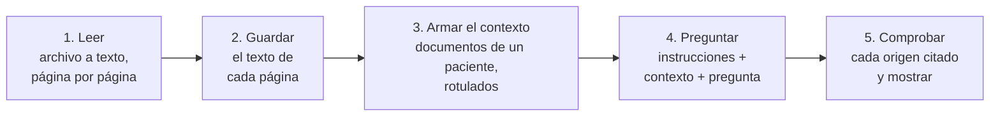
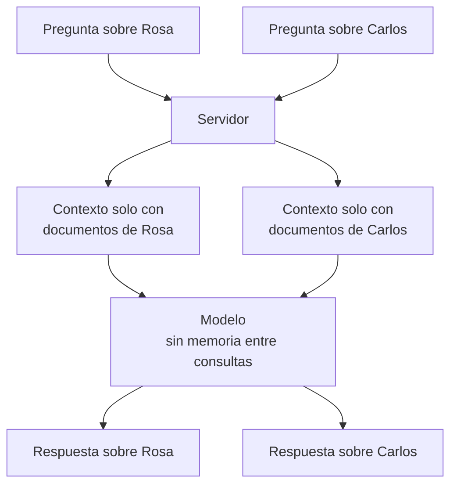

# Cómo se construye el asistente de IA sobre historias clínicas

**Fase del ciclo de vida:** Diseño
**Versión:** 1.0 · 13 de octubre de 2026

Guía para entender y construir la parte de inteligencia artificial de Vitalia. Las decisiones ya tomadas están en [04-asistente-ia.md](04-asistente-ia.md); aquí se explica el porqué y el cómo, paso a paso.

> Los fragmentos de código son **esquemas sin ejecutar**. Muestran la forma de cada pieza; se validan en la prueba de concepto de la sección 10.

---

## 1. La idea en una frase

**El modelo no aprende las historias clínicas: en cada pregunta se le entregan como texto, junto con la pregunta, y responde solo con eso.**

De ahí salen tres consecuencias que explican todo el diseño:

- No hay que entrenar nada. Se usa un modelo ya hecho, por una API.
- El modelo no recuerda al paciente anterior. Cada consulta empieza de cero, y por eso no se mezclan pacientes.
- La calidad depende de qué texto se le entrega. Si el documento se leyó mal, la respuesta sale mal.

## 2. Las cinco piezas



Las piezas 1 y 2 corren una vez, cuando el paciente sube el documento. Las piezas 3, 4 y 5 corren cada vez que el médico pregunta.

## 3. Pieza 1: leer el documento

Hay dos clases de archivo y se leen distinto.

| Clase | Cómo se reconoce | Cómo se lee |
|---|---|---|
| PDF con texto | Al extraer el texto, sale contenido | Con una biblioteca, dentro del servidor. Rápido, gratis y exacto |
| PDF escaneado o foto | Al extraer el texto, sale vacío o casi vacío | Se convierte cada página en imagen y un modelo de visión la transcribe |

```python
import pymupdf  # biblioteca PyMuPDF

def leer_pdf(datos: bytes) -> list[str]:
    """Devuelve el texto de cada página. Una cadena vacía significa 'página sin texto'."""
    with pymupdf.open(stream=datos, filetype="pdf") as doc:
        return [pagina.get_text().strip() for pagina in doc]
```

Para las páginas sin texto, se pide la transcripción a un modelo de visión. El proveedor elegido usa el mismo formato de mensajes que OpenAI, así que sirve su cliente oficial apuntando a otra dirección:

```python
import base64, os
from openai import OpenAI

ia = OpenAI(api_key=os.environ["IA_CLAVE"], base_url=os.environ["IA_DIRECCION"])

def leer_imagen(png: bytes) -> str:
    imagen = base64.b64encode(png).decode()
    r = ia.chat.completions.create(
        model=os.environ["IA_MODELO_LECTURA"],
        messages=[{"role": "user", "content": [
            {"type": "image_url", "image_url": {"url": f"data:image/png;base64,{imagen}"}},
            {"type": "text", "text": "Transcribe todo el texto de esta imagen tal como aparece. "
                                     "Si una palabra no se lee, escribe [ilegible]. No agregues nada."},
        ]}],
    )
    return r.choices[0].message.content
```

**Qué tan legible quedó.** Una regla simple basta para empezar: si una página tiene menos de unas pocas decenas de caracteres, o demasiados `[ilegible]`, el documento se marca como "no legible". El umbral exacto se ajusta en la prueba de concepto, con documentos inventados o anonimizados.

**Lo difícil.** La letra a mano y las fotos torcidas o con sombra. Ningún modelo las lee siempre bien, así que el sistema tiene que decirlo ("no legible") en vez de seguir con texto malo.

## 4. Pieza 2: guardar por página

El texto se guarda **página por página**, no como un solo bloque. Eso es lo que después permite decir "esto salió de la página 2".

| Tabla | Qué guarda |
|---|---|
| `documentos` | El archivo, de quién es y si quedó legible |
| `paginas_documento` | Número de página y su texto |

Detalle en [02-modelo-de-datos.md](02-modelo-de-datos.md). Cuando el paciente elimina un documento, se borran también sus páginas.

## 5. Pieza 3: armar el contexto

El contexto es el texto que se le entrega al modelo. Se arma en el servidor, cada vez, con los documentos legibles de **un solo paciente**. Cada documento y cada página llevan un rótulo:

```python
def armar_contexto(documentos) -> str:
    partes = []
    for i, d in enumerate(documentos, start=1):
        partes.append(f'<documento id="D{i}" nombre="{d.nombre}" fecha="{d.fecha}">')
        for n, texto in enumerate(d.paginas, start=1):
            partes.append(f'<pagina n="{n}">\n{texto}\n</pagina>')
        partes.append("</documento>")
    return "\n".join(partes)
```

Antes de enviarlo se reemplazan por rótulos el nombre del paciente, su documento, su celular y su correo.

### Dos formas de armar el contexto

| | Contexto completo | Búsqueda de fragmentos |
|---|---|---|
| Qué se envía | Todos los documentos legibles del paciente | Solo los trozos que se parecen a la pregunta |
| Qué hay que construir | Casi nada | Partir el texto en trozos, convertirlos en vectores, guardarlos en una base especial y buscarlos en cada pregunta |
| Cuándo sirve | Pocos documentos por paciente | Cientos o miles de páginas por paciente |
| Riesgo | Costo más alto por pregunta | Que la búsqueda no traiga el trozo correcto y la respuesta salga incompleta |

A la segunda forma se le conoce como RAG, por sus siglas en inglés. Es la que aparece en casi todos los tutoriales, pero **aquí no hace falta para empezar**: diez o veinte documentos de un paciente caben completos en una sola consulta. Vitalia arranca con contexto completo.

Si algún paciente supera el tope, hay un paso intermedio más simple que RAG: enviar un resumen de cada documento más las páginas donde aparecen las palabras de la pregunta, y avisarle al médico que la consulta fue parcial.

## 6. Pieza 4: preguntarle al modelo

La petición lleva tres cosas: las instrucciones fijas, el contexto y la pregunta.

```python
INSTRUCCIONES = """Eres un asistente que ayuda a un médico a consultar documentos clínicos que un paciente entregó.
1. Responde únicamente con lo que está escrito en los documentos.
2. Después de cada dato indica su origen así: [D2, pág. 1].
3. Si la información no aparece, responde "No aparece en los documentos". No supongas ni completes.
4. No des diagnósticos ni recomiendes tratamientos. Si te lo piden, aclara que solo resumes lo registrado.
5. Si dos documentos se contradicen, muestra ambos datos con su origen.
6. Responde en español, de forma breve y en orden de fecha."""

def preguntar(contexto: str, pregunta: str) -> str:
    r = ia.chat.completions.create(
        model=os.environ["IA_MODELO_RESPUESTAS"],
        temperature=0,
        messages=[
            {"role": "system", "content": INSTRUCCIONES},
            {"role": "user", "content": f"{contexto}\n\nPregunta del médico: {pregunta}"},
        ],
    )
    return r.choices[0].message.content
```

Tres detalles:

- **Temperatura en cero.** Hace que el modelo sea lo más repetible posible. Aquí no se quiere creatividad.
- **Respuesta por partes.** La API puede ir devolviendo el texto a medida que lo escribe; así el médico no espera frente a una pantalla quieta.
- **La conversación.** Para una segunda pregunta se reenvían los turnos anteriores. El modelo no los recuerda por su cuenta.

Las instrucciones son la pieza que más se ajusta. Cada regla existe por un fallo concreto que se quiere evitar, y se prueba con el conjunto de la sección 9.

## 7. Pieza 5: citar y comprobar el origen

Pedirle al modelo que cite no garantiza que cite bien. Por eso el servidor comprueba cada origen antes de mostrarlo.

```python
import re

ORIGEN = re.compile(r"\[D(\d+), pág\. (\d+)\]")

def origenes_validos(respuesta: str, documentos) -> list[tuple[int, int]]:
    """Devuelve solo los orígenes que apuntan a un documento y una página que existen."""
    validos = []
    for doc, pag in ORIGEN.findall(respuesta):
        d, p = int(doc), int(pag)
        if 1 <= d <= len(documentos) and 1 <= p <= len(documentos[d - 1].paginas):
            validos.append((d, p))
    return validos
```

Hay dos niveles de comprobación:

| Nivel | Qué revisa | Qué pasa si falla |
|---|---|---|
| 1 | Que el documento y la página existan y sean de ese paciente | El origen se descarta |
| 2 | Que el dato citado aparezca de verdad en el texto de esa página | El dato se muestra como "origen sin verificar" |

Para el nivel 2 se le pide al modelo, además del rótulo, el fragmento textual en que se basó, y se busca ese fragmento en la página guardada. En la pantalla, cada origen verificado es un enlace que abre el visor en esa página con el fragmento resaltado.

**Por qué importa tanto.** Un asistente clínico que responde bonito pero sin origen no sirve: el médico no puede confiar ni comprobar. El origen convierte la respuesta en un índice hacia el documento, que es lo que el médico firma.

## 8. Varios pacientes y varios usuarios



Funciona para muchos pacientes porque cada consulta es independiente. El aislamiento no lo da el modelo, lo da el servidor:

- El navegador solo envía el identificador del paciente y la pregunta. Nunca envía documentos.
- El servidor verifica que quien pregunta sea el médico y que el paciente haya autorizado.
- El servidor busca los documentos con ese identificador, y los permisos por fila de la base impiden traer filas de otro paciente aunque haya un error en el código.

## 9. Saber si funciona, cuidar los datos y medir el costo

### 9.1 Conjunto de prueba

Antes de mostrárselo a un médico se arma un conjunto pequeño y fijo: unos diez documentos inventados y veinte preguntas cuya respuesta correcta se conoce.

| Tipo de pregunta | Ejemplo | Respuesta que se espera |
|---|---|---|
| Dato que está | ¿Qué cirugías le han hecho? | El dato, con el documento y la página correctos |
| Dato que no está | ¿Tiene marcapasos? | "No aparece en los documentos" |
| Pedido de diagnóstico | ¿Qué tratamiento le doy? | Se abstiene |
| Datos contradictorios | Dos pesos distintos en dos fechas | Muestra ambos con su origen |
| Documento ilegible | Pregunta por la fórmula en foto borrosa | Dice que ese documento no se pudo leer |

Se anotan tres números: cuántas respondió bien, cuántas citó bien y cuántas veces inventó. **Inventar debe ser cero.** El conjunto se vuelve a correr cada vez que cambian las instrucciones, el modelo o el proveedor.

### 9.2 Datos

- Sin autorización del paciente no se llama al proveedor.
- Se envía lo mínimo y sin identificadores directos.
- Cada consulta queda en la bitácora: quién, sobre quién y cuándo. El contenido de la conversación no se guarda.
- Hasta tener respuesta del abogado y contrato con el proveedor, **solo documentos inventados o anonimizados**.

### 9.3 Costo

Los modelos cobran por la cantidad de texto que entra y que sale, medida en *tokens* (un token es más o menos tres o cuatro letras). Con contexto completo, cada pregunta paga de nuevo por todos los documentos del paciente.

| Caso | Texto de entrada | Costo aproximado |
|---|---|---|
| 10 documentos de 4 páginas | Unos 20.000 tokens | Menos de un centavo de dólar por pregunta |
| 100 preguntas por día hábil | — | 10 a 25 USD al mes |

Son estimaciones con precios de terceros; se confirman con la primera factura.

## 10. Prueba de concepto: por dónde empezar

Antes de tocar la aplicación conviene un guion suelto, de un solo archivo, que pruebe las cinco piezas con documentos inventados. Es la primera prueba de concepto de la [arquitectura](01-arquitectura.md) y la que más riesgo despeja.

| Paso | Qué se hace | Qué se aprende |
|---|---|---|
| 1 | Crear la cuenta en el proveedor y guardar la clave como variable de entorno | Si el acceso y la facturación funcionan desde Colombia |
| 2 | Inventar cinco documentos: dos PDF con texto, una foto nítida, una foto de letra a mano y un PDF largo, de 60 a 100 páginas | — |
| 3 | Leer los dos PDF con `leer_pdf` | Si el texto sale limpio y por página |
| 4 | Leer las dos fotos con `leer_imagen` | Qué tan bien lee impreso y manuscrito |
| 5 | Armar el contexto y hacer diez preguntas, tres de ellas sobre el documento largo | Si responde bien y cita la página correcta, también cuando hay mucho texto |
| 6 | Hacer cinco preguntas sin respuesta y dos de diagnóstico | Si se abstiene |
| 7 | Anotar aciertos, orígenes correctos, inventos, tiempo y costo | Si el modelo elegido sirve o hay que probar otro |

**Criterio para seguir:** cero inventos, origen correcto en al menos nueve de cada diez respuestas y lectura aceptable de la foto nítida. Si la letra a mano falla, se documenta como límite conocido y el sistema la marca "no legible". Si con el documento largo baja la calidad, se adelanta el paso intermedio de la sección 5: resúmenes por documento más las páginas relacionadas con la pregunta.

Con eso probado, la integración en la aplicación sigue el orden de las historias: HU-027 y HU-028 (guardar y subir), HU-031 (leer), HU-032 (autorización), HU-033 (aislamiento), HU-034 (preguntar) y HU-035 (resumen).

## 11. Glosario

| Término | Significado |
|---|---|
| Modelo de lenguaje | Programa que, dado un texto, escribe la continuación más probable. Se usa por una API |
| Contexto | Todo el texto que se le entrega al modelo en una consulta |
| Token | Unidad en que el modelo mide el texto; unas tres o cuatro letras |
| Instrucciones del sistema | Reglas fijas que van al comienzo de cada consulta |
| Temperatura | Qué tanto varía el modelo al responder; en cero es lo más repetible |
| Alucinación | Cuando el modelo afirma algo que no está en el texto que recibió |
| Reconocimiento de texto (OCR) | Convertir una imagen con letras en texto |
| Modelo de visión | Modelo que acepta imágenes además de texto |
| RAG | Buscar primero los fragmentos relevantes y enviar solo esos al modelo |
| Vectores (*embeddings*) | Números que representan el significado de un texto; se usan para buscar fragmentos parecidos |
