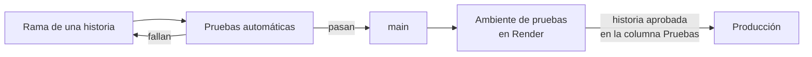

# Herramientas y entrega

**Fase del ciclo de vida:** Diseño
**Versión:** 1.2 · 26 de octubre de 2026

Con qué piezas concretas se construye Vitalia, con qué servicios se trabaja y cómo llega el código a Render. Completa la [arquitectura](01-arquitectura.md), que decide los lenguajes y las capas.

Todo lo de este documento es **propuesta de diseño**: cada pieza está detrás de una capa y se puede cambiar sin rehacer el resto. No se fijan números de versión; se toma la última estable al empezar.

---

## 1. Servidor

| Para qué | Pieza | Por qué esta |
|---|---|---|
| Lenguaje y paquetes | Python 3.13 con `uv` | Ya están instalados en el computador de desarrollo |
| API | FastAPI con Uvicorn | Decisión D-10 |
| Acceso a la base | SQLAlchemy 2, solo su núcleo, sobre `asyncpg` | Asíncrono, como pide la sección 8 de la arquitectura. Sin el mapeo de objetos: las consultas se escriben a la vista, que es donde se controla la rapidez |
| Migraciones | Alembic, con las migraciones escritas en SQL | Los permisos por fila, los disparadores y la restricción contra choques de citas solo se pueden escribir en SQL |
| Validación de lo que entra | Pydantic, solo en la capa de entrada | Viene con FastAPI. El dominio usa clases simples de Python |
| Contraseñas | `argon2-cffi` | RNF-04 |
| Leer PDF y convertir páginas en imagen | `pypdfium2` | Lee texto y dibuja páginas con una sola pieza. Ver la nota de licencia |
| Generar la copia de la historia clínica | ReportLab | Produce PDF con texto seleccionable (HU-046, CA-4) sin instalar nada en el sistema |
| Archivos | `boto3` | Habla con cualquier almacenamiento compatible con S3 |
| IA y correo | `httpx`, y el cliente de OpenAI para la IA | El proveedor de IA usa ese formato. Asíncronos y con tiempo máximo de espera |
| Pruebas | `pytest` | Con una base PostgreSQL de verdad para la capa de adaptadores |
| Estilo y errores comunes | `ruff` | Una sola herramienta para formato y revisión |
| Tipos | `mypy` | Los puertos son contratos; conviene que una herramienta revise que los adaptadores los cumplen |
| Regla de dependencia entre capas | `import-linter` | Es la prueba que falla si el dominio importa algo de afuera (arquitectura, sección 7.1) |

**Nota de licencia.** La [guía del asistente](07-como-se-construye-el-asistente.md) muestra sus ejemplos con PyMuPDF. Esa biblioteca se publica con licencia AGPL, que obliga a entregar el código fuente del sistema a quien lo use por la red, o a comprar una licencia comercial. `pypdfium2` hace lo mismo con una licencia permisiva. Los ejemplos de la guía siguen sirviendo para entender la idea; al construir se usa `pypdfium2`.

## 2. Pantallas

| Para qué | Pieza | Por qué esta |
|---|---|---|
| Base | React con Vite y TypeScript | Decisión A-01 |
| Rutas | React Router | Parte el código por zona: paciente y médico (arquitectura, sección 8.2) |
| Datos del servidor | TanStack Query | Guarda en memoria lo ya pedido y lo borra al salir. Nada queda en el disco del navegador |
| Formularios | React Hook Form | El formulario de la historia clínica es largo; esta pieza evita redibujarlo completo en cada tecla |
| Estilos | CSS con variables, un archivo por pieza. Sin biblioteca de estilos | Las variables son los colores y medidas de la [base visual](08-base-visual.md) |
| Iconos | `@phosphor-icons/react` | El dueño del proyecto pidió iconos que no se vean genéricos y confirmó esta biblioteca (D-25, D-26). Los del lienzo son provisionales. Ver la sección 6 de la [base visual](08-base-visual.md) |
| Calendario | Hecho a mano con las piezas del lienzo | El mes es una rejilla, y el día y la semana son listas. Una biblioteca de calendario pesa más que todo el resto y no se parece al diseño aprobado |
| Visor de documentos | `react-pdf`, que usa pdf.js | Se descarga solo al abrir un documento |
| Fechas y horas | Las funciones del propio navegador, con la zona de Colombia | No hace falta una biblioteca |
| Pruebas | Vitest y Testing Library; Playwright para unos pocos recorridos completos | — |

## 3. Servicios y entorno de trabajo

El dueño del proyecto decidió montar los servicios **en la nube desde el primer día**, sin instalar nada en el computador (D-27). En el computador de desarrollo hay Python, Node, `uv` y git, y con eso basta.

| Necesidad | Cómo se resuelve |
|---|---|
| Base de datos | Para programar, PostgreSQL 18 en Docker (`docker-compose.yml`, D-29), con la imagen `pgvector/pgvector:pg18-trixie`, que es la oficial de PostgreSQL 18 sobre Debian trixie más la extensión `pgvector` (D-30); trixie porque es la base de `postgres:18`, y la misma versión de glibc ordena igual el texto del volumen ya creado. Las pruebas de GitHub usan la misma. `pgvector` solo lo instala un superusuario: el guion de arranque de Docker y el de las pruebas lo dejan en `template1`, y la migración 0005 solo confirma que esté. En Render se comprueba al publicar. Para publicar, PostgreSQL 18 en Render. En los dos, `vitalia_dev` es la base de trabajo y las pruebas crean y borran `vitalia_pruebas` |
| Archivos | Cloudflare R2, espacio `vitalia-dev`. Las pruebas escriben bajo un prefijo propio y lo borran |
| Correo | Un adaptador que escribe el correo en la consola en vez de enviarlo, hasta que exista el servicio de correo |
| IA | Qwen, con la clave del dueño del proyecto. Las pruebas automáticas usan un adaptador de mentira con respuestas fijas y vectores calculados de las palabras del texto: no gastan y la búsqueda se puede probar igual |
| Configuración | El archivo `servidor/.env`, que nunca entra al repositorio, y `servidor/.env.example` con los nombres de las variables y sin valores |
| Datos | Un guion de datos inventados: un médico, unos pocos pacientes, citas y documentos. Nace con las primeras tablas |

El adaptador de correo en consola y el de IA de mentira existen gracias a los puertos de la arquitectura limpia.

**Por qué R2 y no Render ni MinIO.** El almacenamiento de objetos de Render está en alfa con lista de espera. MinIO dejó de publicarse en 2026. R2 habla el mismo protocolo S3, así que cambiar de proveedor sigue siendo un asunto de configuración.

**Lo que cuesta trabajar contra la nube.** Cada instrucción a la base cruza internet hasta Estados Unidos. Por eso las pruebas se separan: las del dominio y los casos de uso no tocan la base y se corren a cada cambio (`uv run pytest -m "not bd"`); las de base, antes de unir cada historia.

### 3.1 PostgreSQL en Render

1. Crear la cuenta en https://render.com, entrando con GitHub.
2. **New → Postgres**, con estos valores:

   | Campo | Valor |
   |---|---|
   | Name | `vitalia-bd` |
   | Database | `vitalia_dev` |
   | User | `vitalia_migraciones` |
   | Region | Virginia (US East) |
   | PostgreSQL Version | 18 |
   | Plan | Free |

3. En **Connections**, copiar **External Database URL** y pegarla tal cual en `BD_URL_MIGRACIONES`.

Ese usuario es el dueño de las tablas y solo lo usan las migraciones. El de la aplicación, `vitalia_api`, se crea con SQL, sin privilegios de dueño, y su dirección va en `BD_URL`.

El plan gratuito da 1 GB, no tiene respaldos y **vence a los 30 días de creada la base**, con 14 más de gracia. Sirve para construir con datos inventados; antes de esa fecha se pasa al plan pago.

### 3.2 Archivos en Cloudflare R2

1. Crear la cuenta en https://dash.cloudflare.com/sign-up y entrar a **R2 Object Storage**.
2. **Create bucket**: nombre `vitalia-dev`, ubicación *Eastern North America*. Sin acceso público.
3. **Overview → API Tokens → Manage → Create Account API token**: permiso **Object Read & Write**, limitado al espacio `vitalia-dev`.
4. El secreto se muestra una sola vez. Los datos van a `servidor/.env`:

   | Dato de Cloudflare | Variable |
   |---|---|
   | Endpoint `https://<id de cuenta>.r2.cloudflarestorage.com` | `ARCHIVOS_DIRECCION` |
   | Access Key ID | `ARCHIVOS_CLAVE_ID` |
   | Secret Access Key | `ARCHIVOS_CLAVE_SECRETA` |
   | Nombre del espacio | `ARCHIVOS_ESPACIO` |

### 3.3 Clave de la IA

1. Crear la cuenta en https://account.alibabacloud.com/register/intl_register.htm.
2. Entrar a https://modelstudio.console.alibabacloud.com/ y aceptar los términos.
3. Elegir la región **Singapore**. La clave, la dirección y los modelos son por región.
4. Copiar el identificador del espacio de trabajo: https://modelstudio.console.alibabacloud.com/ap-southeast-1/settings/workspace
5. Crear la clave: https://modelstudio.console.alibabacloud.com/ap-southeast-1/settings/api-key. Se muestra una sola vez.
6. En `servidor/.env`:

   | Variable | Valor |
   |---|---|
   | `IA_CLAVE` | La clave |
   | `IA_DIRECCION` | `https://<id del espacio>.ap-southeast-1.maas.aliyuncs.com/compatible-mode/v1` |
   | `IA_MODELO_RESPUESTAS` | `qwen3.7-plus` |
   | `IA_MODELO_LECTURA` | `qwen-vl-ocr-2025-11-20` |
   | `IA_MODELO_VECTORES` | `qwen3.7-text-embedding` |
   | `IA_DIMENSIONES` | `1024` |

## 4. Repositorio y ramas

| Tema | Regla |
|---|---|
| Repositorio remoto | Privado. Propuesta: GitHub. Hoy no hay ninguno: la única copia está en un computador. Render además lo necesita para desplegar |
| Rama principal | `main`. La rama actual se llama `master` y se renombra al crear el remoto |
| Trabajo | Una rama corta por historia, con su número: `hu-006-roles-y-permisos`. Se une a `main` cuando la historia sale de la columna Desarrollo |
| Commits | En español, a nombre del dueño del proyecto |
| Lo que nunca entra | Claves, el archivo `.env` y datos de pacientes reales |

## 5. Pruebas automáticas y despliegue

**Qué corren las pruebas automáticas**, en este orden: estilo (`ruff`), tipos (`mypy`), regla de dependencia entre capas (`import-linter`), pruebas del servidor contra un PostgreSQL de verdad, pruebas de las pantallas y construcción del sitio.

Dentro de las pruebas del servidor va la de los permisos por fila, que recorre el catálogo de la base y falla si una tabla quedó sin política (HU-036, CA-4). Eso es lo que "hace fallar el despliegue".

| Paso | Cómo |
|---|---|
| Dónde corren las pruebas | En el servicio de integración del repositorio remoto. Propuesta: GitHub Actions |
| Despliegue al ambiente de pruebas | Render despliega `main` solo **después de que pasan las pruebas**. Es una opción que Render trae |
| Migraciones | Corren como orden previa al despliegue, con el usuario dueño de las tablas. La aplicación usa `vitalia_api`, que no lo es |
| Despliegue a producción | A mano, cuando la historia sale aprobada de la columna Pruebas del tablero |
| Si un despliegue sale mal | Render permite volver al despliegue anterior. Las migraciones se escriben para poder deshacerse |

**Variables de configuración.** Las de la sección 4 de los [diagramas](06-diagramas-de-arquitectura.md), más `BD_URL_MIGRACIONES` para el usuario dueño de las tablas. Cada ambiente tiene las suyas. Las claves viven en Render, nunca en el repositorio.

## 6. Qué hace falta de parte del dueño del proyecto

| Cuenta o recurso | Para qué | Cuándo |
|---|---|---|
| Repositorio remoto privado | Respaldo, pruebas automáticas y despliegue | Antes de la primera historia |
| PostgreSQL en Render | Desarrollar y probar los permisos por fila | Antes de la primera historia |
| Cloudflare R2 | Guardar documentos | Antes de la primera historia; se usa desde HU-027 |
| Proveedor de IA | Lectura de documentos y asistente | Antes de la primera historia; se usa desde HU-031 |
| Servicio web y sitio en Render | Ambiente de pruebas publicado | Al cerrar el registro y el ingreso |
| Servicio de correo | Recuperación de contraseña y avisos | Para HU-005 |
| Dominio propio | La cookie de sesión entre el sitio y la API | Para la prueba de la cookie de sesión |

## 7. Orden de arranque del Desarrollo

1. Los servicios de la sección 3 y el repositorio remoto.
2. Comprobar cada servicio: privilegios del usuario dueño en Render y creación de `vitalia_api`; guardar y abrir un archivo en R2 con enlace firmado; una llamada a cada modelo.
3. Registro e ingreso: HU-006, HU-036, HU-037, HU-001, HU-002, HU-003, HU-004 y HU-007.
4. Citas, y después documentos y resumen con IA.

El detalle y el estado de cada paso están en la sección 4 de [ESTADO.md](../ESTADO.md).

## Fuentes

- [Render: despliegues, pruebas previas y orden previa al despliegue](https://render.com/docs/deploys)
- [Render: crear y conectar PostgreSQL](https://render.com/docs/postgresql-creating-connecting)
- [Render: plan gratuito](https://render.com/docs/free)
- [Cloudflare R2: claves de acceso](https://developers.cloudflare.com/r2/api/tokens/)
- [Cloudflare R2: precios](https://developers.cloudflare.com/r2/pricing/)
- [Alibaba Cloud Model Studio: primera llamada](https://www.alibabacloud.com/help/en/model-studio/first-api-call-to-qwen)
