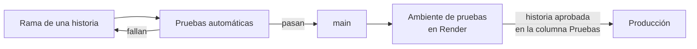

# Herramientas y entrega

**Fase del ciclo de vida:** Diseño
**Versión:** 1.0 · 13 de octubre de 2026

Con qué piezas concretas se construye Vitalia, cómo se trabaja en el computador de quien programa y cómo llega el código a Render. Completa la [arquitectura](01-arquitectura.md), que decide los lenguajes y las capas.

Todo lo de este documento es **propuesta de diseño**: cada pieza está detrás de una capa y se puede cambiar sin rehacer el resto. No se fijan números de versión; se toma la última estable al empezar.

---

## 1. Servidor

| Para qué | Pieza | Por qué esta |
|---|---|---|
| Lenguaje y paquetes | Python 3.13 con `uv` | Ya están instalados en el computador de desarrollo |
| API | FastAPI con Uvicorn | Decisión D-10 |
| Acceso a la base | SQLAlchemy 2, solo su núcleo, sobre `asyncpg` | Asíncrono, como pide la sección 8 de la arquitectura. Sin el mapeo de objetos: las consultas se escriben a la vista, que es donde se controla la rapidez |
| Migraciones | Alembic, con las migraciones escritas en SQL | Los permisos por fila, los disparadores y la restricción contra choques de citas solo se pueden escribir en SQL |
| Validación de lo que entra | Pydantic, solo en la capa de entrada | Viene con FastAPI. El dominio usa clases simples de Python |
| Contraseñas | `argon2-cffi` | RNF-04 |
| Leer PDF y convertir páginas en imagen | `pypdfium2` | Lee texto y dibuja páginas con una sola pieza. Ver la nota de licencia |
| Generar la copia de la historia clínica | ReportLab | Produce PDF con texto seleccionable (HU-046, CA-4) sin instalar nada en el sistema |
| Archivos | `boto3` | Habla con cualquier almacenamiento compatible con S3 |
| IA y correo | `httpx`, y el cliente de OpenAI para la IA | El proveedor de IA usa ese formato. Asíncronos y con tiempo máximo de espera |
| Pruebas | `pytest` | Con una base PostgreSQL de verdad para la capa de adaptadores |
| Estilo y errores comunes | `ruff` | Una sola herramienta para formato y revisión |
| Tipos | `mypy` | Los puertos son contratos; conviene que una herramienta revise que los adaptadores los cumplen |
| Regla de dependencia entre capas | `import-linter` | Es la prueba que falla si el dominio importa algo de afuera (arquitectura, sección 7.1) |

**Nota de licencia.** La [guía del asistente](07-como-se-construye-el-asistente.md) muestra sus ejemplos con PyMuPDF. Esa biblioteca se publica con licencia AGPL, que obliga a entregar el código fuente del sistema a quien lo use por la red, o a comprar una licencia comercial. `pypdfium2` hace lo mismo con una licencia permisiva. Los ejemplos de la guía siguen sirviendo para entender la idea; al construir se usa `pypdfium2`.

## 2. Pantallas

| Para qué | Pieza | Por qué esta |
|---|---|---|
| Base | React con Vite y TypeScript | Decisión A-01 |
| Rutas | React Router | Parte el código por zona: paciente y médico (arquitectura, sección 8.2) |
| Datos del servidor | TanStack Query | Guarda en memoria lo ya pedido y lo borra al salir. Nada queda en el disco del navegador |
| Formularios | React Hook Form | El formulario de la historia clínica es largo; esta pieza evita redibujarlo completo en cada tecla |
| Estilos | CSS con variables, un archivo por pieza. Sin biblioteca de estilos | Las variables son los colores y medidas de la [base visual](08-base-visual.md) |
| Iconos | `@phosphor-icons/react` | El dueño del proyecto pidió iconos que no se vean genéricos y confirmó esta biblioteca (D-25, D-26). Los del lienzo son provisionales. Ver la sección 6 de la [base visual](08-base-visual.md) |
| Calendario | Hecho a mano con las piezas del lienzo | El mes es una rejilla, y el día y la semana son listas. Una biblioteca de calendario pesa más que todo el resto y no se parece al diseño aprobado |
| Visor de documentos | `react-pdf`, que usa pdf.js | Se descarga solo al abrir un documento |
| Fechas y horas | Las funciones del propio navegador, con la zona de Colombia | No hace falta una biblioteca |
| Pruebas | Vitest y Testing Library; Playwright para unos pocos recorridos completos | — |

## 3. Entorno local

En el computador de desarrollo hay Python, Node, `uv` y git. **Falta PostgreSQL.**

| Necesidad | Cómo se resuelve en local |
|---|---|
| Base de datos | PostgreSQL instalado en Windows con el instalador oficial, en la misma versión mayor que se elija en Render. Dos bases: una de desarrollo y otra que las pruebas crean y borran |
| Archivos | Un adaptador que guarda en una carpeta del disco. Cumple el mismo puerto que el de S3 |
| Correo | Un adaptador que escribe el correo en la consola en vez de enviarlo |
| IA | Un adaptador de mentira con respuestas fijas, para las pruebas. El proveedor real se usa solo cuando hay clave en la configuración |
| Configuración | Un archivo `.env` que nunca entra al repositorio, y un `.env.example` con los nombres de las variables y sin valores |
| Datos | Un guion de datos inventados: un médico, unos pocos pacientes, citas, documentos y atenciones. Sirve para desarrollar, para las pruebas y para mostrar el sistema |

Los tres adaptadores locales existen gracias a los puertos de la arquitectura limpia. El almacenamiento real, con sus enlaces firmados, se prueba en el ambiente de pruebas de Render.

Docker no es necesario. Si más adelante se quiere, el mismo entorno se puede describir en un archivo de Docker Compose sin cambiar el código.

## 4. Repositorio y ramas

| Tema | Regla |
|---|---|
| Repositorio remoto | Privado. Propuesta: GitHub. Hoy no hay ninguno: la única copia está en un computador. Render además lo necesita para desplegar |
| Rama principal | `main`. La rama actual se llama `master` y se renombra al crear el remoto |
| Trabajo | Una rama corta por historia, con su número: `hu-006-roles-y-permisos`. Se une a `main` cuando la historia sale de la columna Desarrollo |
| Commits | En español, a nombre del dueño del proyecto |
| Lo que nunca entra | Claves, el archivo `.env` y datos de pacientes reales |

## 5. Pruebas automáticas y despliegue

**Qué corren las pruebas automáticas**, en este orden: estilo (`ruff`), tipos (`mypy`), regla de dependencia entre capas (`import-linter`), pruebas del servidor contra un PostgreSQL de verdad, pruebas de las pantallas y construcción del sitio.

Dentro de las pruebas del servidor va la de los permisos por fila, que recorre el catálogo de la base y falla si una tabla quedó sin política (HU-036, CA-4). Eso es lo que "hace fallar el despliegue".

| Paso | Cómo |
|---|---|
| Dónde corren las pruebas | En el servicio de integración del repositorio remoto. Propuesta: GitHub Actions |
| Despliegue al ambiente de pruebas | Render despliega `main` solo **después de que pasan las pruebas**. Es una opción que Render trae |
| Migraciones | Corren como orden previa al despliegue, con el usuario dueño de las tablas. La aplicación usa `vitalia_api`, que no lo es |
| Despliegue a producción | A mano, cuando la historia sale aprobada de la columna Pruebas del tablero |
| Si un despliegue sale mal | Render permite volver al despliegue anterior. Las migraciones se escriben para poder deshacerse |

**Variables de configuración.** Las de la sección 4 de los [diagramas](06-diagramas-de-arquitectura.md), más `BD_URL_MIGRACIONES` para el usuario dueño de las tablas. Cada ambiente tiene las suyas. Las claves viven en Render, nunca en el repositorio.

## 6. Qué hace falta de parte del dueño del proyecto

| Cuenta o recurso | Para qué | Cuándo |
|---|---|---|
| Repositorio remoto privado | Respaldo, pruebas automáticas y despliegue | Antes de la primera historia |
| PostgreSQL en el computador | Desarrollar y probar los permisos por fila | Antes de la primera historia |
| Render | Ambiente de pruebas | Para la prueba de permisos por fila y la de la cookie de sesión |
| Proveedor de IA | Prueba de concepto del asistente | Para la prueba de concepto de la IA |
| Almacenamiento de archivos | Guardar documentos | Para HU-027 |
| Servicio de correo | Recuperación de contraseña y avisos | Para HU-005 |
| Dominio propio | La cookie de sesión entre el sitio y la API | Para la prueba de la cookie de sesión |

## 7. Orden de arranque del Desarrollo

1. Repositorio remoto, PostgreSQL local y el esqueleto de `servidor/` y `pantallas/` con las pruebas automáticas corriendo.
2. Prueba de concepto de la IA: sección 10 de la [guía del asistente](07-como-se-construye-el-asistente.md).
3. Las otras tres pruebas de concepto de la [arquitectura](01-arquitectura.md).
4. Los cimientos, en el orden de [RELACIONES.md](../historias-de-usuario/RELACIONES.md): HU-006, HU-036, HU-037 y HU-027.

## Fuentes

- [Render: despliegues, pruebas previas y orden previa al despliegue](https://render.com/docs/deploys)
