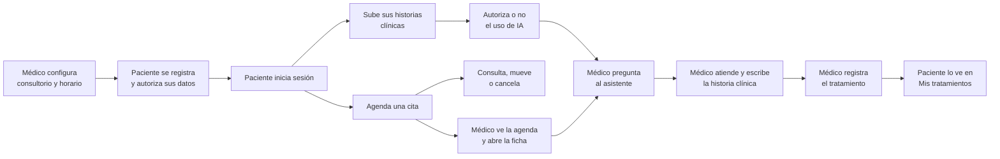

# Alcance y flujo principal

**Fase del ciclo de vida:** Planificación
**Versión:** 2.2 · 26 de octubre de 2026

---

## 1. Qué es Vitalia

Un sistema a la medida para **un consultorio médico general privado en Colombia**. Le permite al médico manejar su agenda y a sus pacientes, y le da un asistente de inteligencia artificial que lee las historias clínicas que el paciente trae de otras atenciones y responde preguntas sobre ellas.

No es un producto para vender a otros consultorios. Se construye para uno.

## 2. Quién lo usa

| Usuario | Qué hace |
|---|---|
| **Médico** | Configura el consultorio, define su horario, agenda y mueve citas, registra pacientes, consulta sus documentos, le pregunta al asistente, escribe la historia clínica de cada atención y registra el tratamiento. Es el único usuario del consultorio: no hay personal de recepción |
| **Paciente** | Se registra, agenda y gestiona sus citas, sube sus historias clínicas, decide si autoriza el uso de inteligencia artificial sobre ellas y consulta sus tratamientos |
| **Sistema** | Calcula los espacios libres, lee los documentos, envía avisos por correo y lleva la bitácora |

## 3. Dentro del alcance

| Épica | Qué cubre | Historias | Puntos |
|---|---|---|---|
| [E1 Cuentas e ingreso](../historias-de-usuario/E1-cuentas-e-ingreso/README.md) | Registro, autorización de datos, ingreso con documento y contraseña, recuperación, cierre de sesión, configuración del consultorio, roles y corrección de datos | 8 | 29 |
| [E2 Calendario de disponibilidad](../historias-de-usuario/E2-calendario-de-disponibilidad/README.md) | Horario semanal, bloqueos, tipos de cita, cálculo de espacios libres | 4 | 19 |
| [E3 Citas](../historias-de-usuario/E3-citas/README.md) | Crear, consultar, mover y cancelar citas por el paciente y por el médico; asistencia; avisos por correo; inicio del paciente | 9 | 32 |
| [E4 Panel del médico](../historias-de-usuario/E4-panel-del-medico/README.md) | Agenda del día, calendario, pacientes, ficha del paciente, botón de cobro sin función | 6 | 22 |
| [E5 Historias clínicas del paciente](../historias-de-usuario/E5-historias-clinicas-del-paciente/README.md) | Carga de documentos por el paciente, visor del médico, almacenamiento privado, lectura para la IA | 5 | 26 |
| [E6 Asistente de IA](../historias-de-usuario/E6-asistente-de-ia/README.md) | Autorización del paciente, preguntas del médico, resumen del paciente, aislamiento por paciente | 4 | 24 |
| [E7 Seguridad base](../historias-de-usuario/E7-seguridad-base/README.md) | Permisos por fila y bitácora de auditoría | 2 | 13 |
| [E8 Tratamientos](../historias-de-usuario/E8-tratamientos/README.md) | El médico registra el tratamiento y el paciente lo consulta en "Mis tratamientos" | 2 | 8 |
| [E9 Historia clínica del consultorio](../historias-de-usuario/E9-historia-clinica-del-consultorio/README.md) | Datos de identificación, pantalla de atención con el asistente a un lado, registro de la consulta, cierre con firma, consulta de atenciones y copia para el paciente | 6 | 27 |
| **Total** | | **46** | **200** |

## 4. Fuera del alcance

**Queda para después.** No se levanta ahora; las historias de la versión anterior están en `archivo/v1/` para retomarlas.

- Envío del Resumen Digital de Atención al Ministerio. La historia clínica guarda los datos para poder generarlo.
- Consentimientos informados de procedimientos dentro del sistema.
- Cuentas para menores de edad.
- Catálogo de medicamentos, aviso de interacciones y recordatorios de cada toma.
- Recordatorios por WhatsApp y medición de adherencia.
- Factura electrónica de la consulta con Factus. Por ahora solo existe un botón de cobro sin función.
- Agente de voz para manejar citas.
- Ingreso con código por SMS.
- Reporte RIPS.

**Fuera del producto.**

- Venta del sistema a otros consultorios y cualquier cobro recurrente por su uso.
- Consultorios con más de una ubicación o con varios profesionales.
- Odontología, otras especialidades y atención de animales.
- Cobro a EPS, telemedicina y atención de urgencias.

> **Advertencia.** Los documentos que sube el paciente son antecedentes de otras atenciones. No reemplazan la historia clínica que el consultorio lleva de sus propias consultas, que ahora vive en el sistema (épica E9) con el contenido mínimo de la Resolución 1995 de 1999. Eso trae obligaciones: lo cerrado no se modifica, se conserva 15 años, y hay que resolver con el abogado la firma y el envío del Resumen Digital de Atención antes de atender pacientes reales. Ver la sección 4 del [marco normativo](03-marco-normativo.md).

## 5. Flujo principal

| Paso | Qué pasa | Historias |
|---|---|---|
| 1 | El médico configura el consultorio: sus datos, su horario semanal, sus bloqueos y los tipos de cita | HU-001, HU-008, HU-009, HU-010 |
| 2 | El paciente se registra y autoriza el tratamiento de sus datos; o lo registra el médico. Los datos se pueden corregir después | HU-002, HU-003, HU-024, HU-040 |
| 3 | El paciente inicia sesión con su documento y su contraseña | HU-004, HU-005, HU-007 |
| 4 | El paciente sube sus historias clínicas y decide si autoriza el uso de IA | HU-027, HU-028, HU-029, HU-031, HU-032 |
| 5 | El paciente agenda una cita en un espacio libre; el médico también puede agendársela | HU-011, HU-012, HU-016 |
| 6 | Cualquiera de los dos consulta, mueve o cancela la cita, y el paciente recibe el aviso | HU-013, HU-014, HU-015, HU-017, HU-019, HU-020 |
| 7 | El médico abre su panel: ve la agenda del día, el calendario y entra a la ficha del paciente | HU-021, HU-022, HU-023, HU-025, HU-026 |
| 8 | El médico revisa los documentos y le pregunta al asistente; recibe el resumen con el documento y la página de origen | HU-030, HU-033, HU-034, HU-035 |
| 9 | El médico atiende: ve el asistente a un lado y escribe la historia clínica en el centro. Al terminar la cierra con su firma y marca la asistencia | HU-018, HU-041, HU-042, HU-043, HU-044 |
| 10 | El médico registra el tratamiento y el paciente lo consulta en "Mis tratamientos" | HU-038, HU-039 |
| 11 | El médico consulta las atenciones anteriores y le entrega copia al paciente si la pide | HU-045, HU-046 |
| Transversal | Cada quien ve solo lo suyo y todo acceso queda registrado | HU-006, HU-036, HU-037 |

## 6. Cómo funciona el asistente con varios pacientes

El modelo de inteligencia artificial no guarda memoria entre consultas. Cada vez que el médico pregunta, el servidor arma la petición únicamente con los documentos del paciente que tiene abierto. Por eso cada paciente queda aislado y varias consultas pueden ocurrir al tiempo sin mezclarse.

- **Volumen.** El servidor lee el texto de cada documento y al modelo le envía solo texto. Los documentos de un paciente, diez o veinte, caben completos en una consulta; el máximo es un tope configurable. Si un paciente sube mucho más, se envían resúmenes por documento más las páginas relacionadas con la pregunta, y el médico ve que la consulta fue parcial.
- **Calidad.** El asistente busca los fragmentos que responden en los documentos y en las atenciones del paciente (D-30), indica el documento y la página, o la atención, de cada dato, y dice "no lo encontré en los documentos ni en las atenciones" cuando no lo encuentra. Las fotos borrosas y las notas a mano bajan la calidad.
- **Límite.** Solo resume lo que está escrito. No diagnostica ni recomienda tratamiento.
- **Permiso.** Sin la autorización del paciente, el asistente no se puede usar sobre sus documentos.
